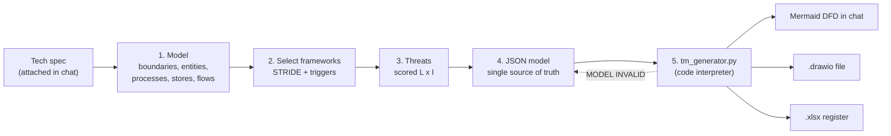
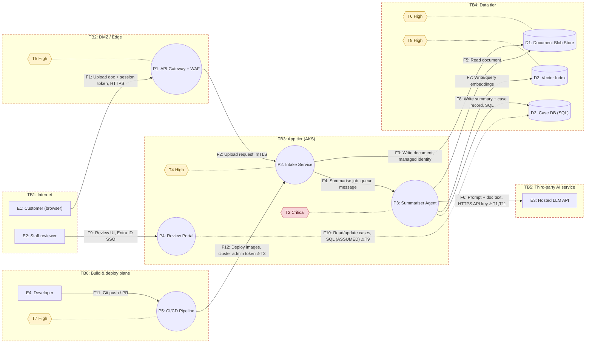

# Copilot Threat Model Agent

A Microsoft 365 Copilot agent that reads a technical specification and returns a **data flow diagram (DFD) with numbered threats on it**, rather than a plain table. Each run produces three outputs that always agree:

1. **A Mermaid DFD shown in the chat.** Trust boundaries, DFD shapes, hexagon badges for Critical/High threats, and `⚠T#` labels on data flows.
2. **An editable draw.io file** (`.drawio`). Opens in draw.io / diagrams.net. Threat badges are attached to their element and move with it.
3. **A threat register** (`.xlsx`). Sorted by severity, with framework IDs, controls and a Status column.

The agent works in a fixed order and uses the same threat frameworks, ID scheme and scoring on every run, so results are consistent:
- STRIDE per element, plus LINDDUN and the relevant OWASP lists;
- fixed IDs: `TB#`, `E#`, `P#`, `D#`, `F#` and `T#`;
- likelihood × impact scoring, with severity checked by the script.

## How it works



The model writes the system description once, as JSON. Then `tm_generator.py` validates it and renders every output from that JSON. It rejects any of these with `MODEL INVALID`, and the agent has to fix them and run it again:
- duplicate IDs;
- broken references (a flow pointing at an element that doesn't exist, a threat targeting nothing);
- likelihood or impact outside 1–5;
- a severity that doesn't match likelihood × impact.

## Example output

The example below was produced from the fictional spec in [`examples/example_spec.md`](examples/example_spec.md).



Open [`examples/example_threat_model.drawio`](examples/example_threat_model.drawio) in draw.io to see the editable version. [`examples/example_threat_model_register.xlsx`](examples/example_threat_model_register.xlsx) is the register.

## Repository layout

| Path | What it is |
|---|---|
| `agent/agent_instructions.txt` | Paste into the agent's Instructions field (~4,400 characters; the limit is 8,000) |
| `agent/tm_generator.txt` | Copy of the generator to attach in chat alongside the spec (most reliable route, see below) |
| `knowledge/TM-0*.docx` | The four knowledge files to upload to the agent |
| `knowledge/src/*.md` | Editable source for the knowledge files |
| `generator/tm_generator.py` | Validator and renderer: JSON → `.drawio` + `.xlsx` + Mermaid |
| `examples/` | Example spec, JSON model, Mermaid, draw.io and register |
| `tools/build_knowledge.py` | Rebuilds TM-03/TM-04 and the `.docx` files from source |
| `tests/test_generator.py` | Checks validation, draw.io completeness and framework IDs |

### Knowledge files

| File | Contents |
|---|---|
| **TM-01 Method and Scoring** | The four threat-modelling questions; DFD element rules; ID conventions; which STRIDE categories apply to each element type; how to word a threat; 1–5 likelihood and impact rubrics; severity bands; coverage rules; quality checklist |
| **TM-02 Threat Library** | Which frameworks to apply when; STRIDE threat patterns and controls; LINDDUN; OWASP Top 10:2025; OWASP API Security Top 10:2023; OWASP Top 10 for LLM Applications 2026; OWASP Top 10 for Agentic Applications 2026; OWASP Top 10 CI/CD Security Risks; common situation → ID mappings |
| **TM-03 Generator and Schema** | JSON model schema and the full generator script |
| **TM-04 Worked Example** | The fully worked example the agent should match |

## Setup (Agent Builder in Microsoft 365 Copilot)

Full Copilot Studio is **not** required.

1. In Microsoft 365 Copilot, choose **New agent → Configure**.
2. Paste `agent/agent_instructions.txt` into **Instructions**.
3. Under **Knowledge**, upload the four files in `knowledge/*.docx` (up to 20 files allowed). If a `.docx` upload fails, export it to PDF and upload that instead.
4. Check that code interpreter is on (**Create documents, charts, and code**). It's on by default in Agent Builder.
5. Add a conversation starter such as *"Threat model the attached spec"*.

### Using the agent

- **Attach the spec directly in the chat** rather than adding it as SharePoint knowledge. Knowledge sources work by search and only return snippets, so the agent would never see the whole spec.
- **Also attach `agent/tm_generator.txt`.** Microsoft doesn't document whether code interpreter can read an agent's knowledge files, but it can read files attached to the chat. With the script attached, the agent doesn't have to copy it out of TM-03.
- **Download the `.drawio` and `.xlsx` before you close the chat.** Files that code interpreter creates are only kept for the session.

### Licensing

Code interpreter needs a **Microsoft 365 Copilot licence**, or Copilot Chat **without** metered usage. Without it, the agent still returns the Mermaid DFD, the threat summary and the open questions, plus the JSON model. To get the draw.io file and the register, save the JSON and run the generator yourself:

```bash
pip install pandas openpyxl
python generator/tm_generator.py model.json my_system
# -> my_system.drawio, my_system_register.xlsx, Mermaid printed to stdout
```

## Frameworks and versions (as of November 2026)

| Framework | IDs cited | Applied when the spec mentions |
|---|---|---|
| STRIDE per element | S T R I D E | Always |
| LINDDUN | L, I, NR, DT, DD, U, NC | Personal data |
| OWASP Top 10:2025 | A01:2025–A10:2025 | Web apps and services (SSRF is now in A01; new A03 Software Supply Chain Failures, A10 Mishandling of Exceptional Conditions) |
| OWASP API Security Top 10:2023 | API1:2023–API10:2023 | APIs, gateways, webhooks |
| OWASP Top 10 for LLM Applications 2026 | LLM01:2026–LLM10:2026 | LLMs, RAG, vector stores (renumbered: Excessive Agency is now LLM03; System Prompt Leakage is now LLM08 Hidden Context Exposure) |
| OWASP Top 10 for Agentic Applications 2026 | ASI01–ASI10 | Agents, tool calling, MCP, agent memory |
| OWASP Top 10 CI/CD Security Risks | CICD-SEC-1–CICD-SEC-10 | Pipelines, runners, registries, signing |
| CWE / CAPEC / ATT&CK / ATLAS / SLSA | Optional | Only when the agent is confident of the ID |

When a framework publishes a new edition, update `knowledge/src/TM-02_Threat_Library.md`, then rebuild and re-upload the files.

## Severity scoring

Risk score = likelihood (1–5) × impact (1–5). The rubrics are in TM-01.

| Score | Severity | Expected action |
|---|---|---|
| 20–25 | Critical | Fix before go-live; architecture change likely |
| 12–19 | High | Fix before go-live or formal risk acceptance |
| 6–11 | Medium | Fix in the delivery plan |
| 1–5 | Low | Accept or fix opportunistically |

## Rebuilding and testing

```bash
pip install pandas openpyxl pytest      # plus pandoc for the .docx build
python tools/build_knowledge.py         # regenerates TM-03, TM-04, the .docx files, examples and agent/tm_generator.txt
python -m pytest tests                  # or: python tests/test_generator.py
```

If you change `generator/tm_generator.py`, run the build so that TM-03 and `agent/tm_generator.txt` match the script.

## Design notes

- **Why Mermaid in chat:** Microsoft 365 Copilot renders Mermaid natively, so you see a diagram without any extra plumbing. The generator never writes `click` directives or links into the diagram. Interactive Mermaid in Copilot was previously used for a data-exfiltration attack, which Microsoft has patched.
- **Why a generator script:** a language model left to draw diagrams freehand produces different layouts and numbering every time. Using one JSON model as the single source of truth, with a validating renderer, keeps the diagram, the draw.io file and the register in agreement.
- **Threats on flows:** Mermaid can only attach a badge to a box, not an arrow. Threats on flows therefore appear as `⚠T#` in the arrow label, and in draw.io the arrow is also coloured by its worst threat.
- **Untrusted input:** the instructions treat the spec as data. Any text in the spec addressed to an AI is reported as a finding, not obeyed.

## Known limitations

- Microsoft doesn't document whether code interpreter reads knowledge files. If the agent paraphrases or truncates the script, attach `agent/tm_generator.txt` to the chat.
- The draw.io layout is a simple column-per-boundary layout. Flows between distant columns may need tidying by hand.
- Very large specs should be modelled as a Level 0 context diagram plus one Level 1 diagram per subsystem; the instructions ask the agent to do this.
- For a fully predictable setup, host `tm_generator.py` as an Azure Function and call it as an action from a full Copilot Studio agent.
