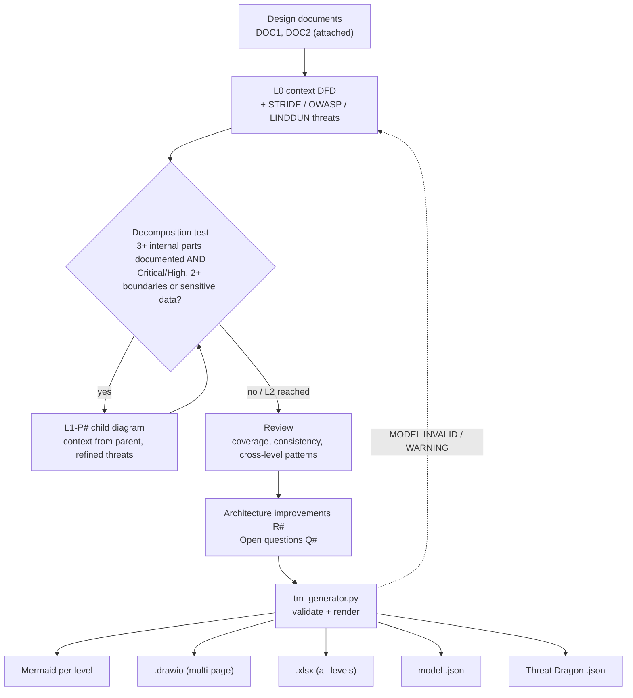
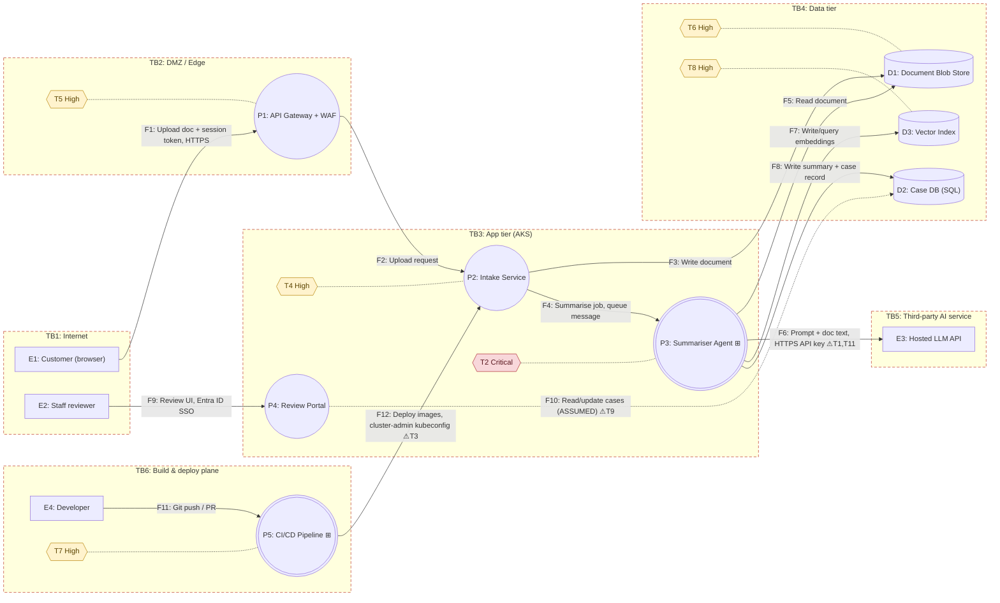
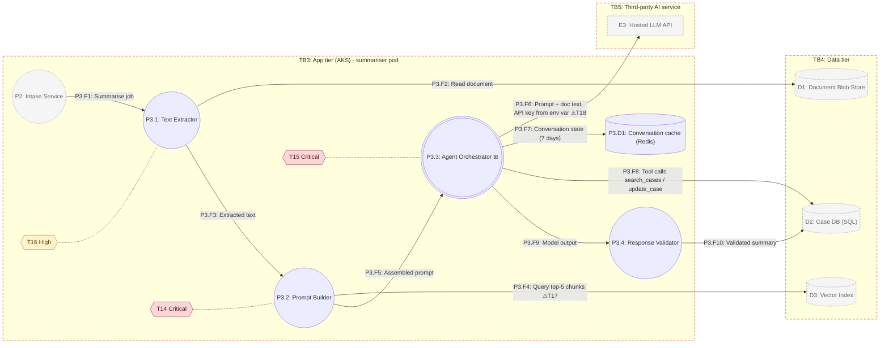

# Copilot Threat Model Agent

A Microsoft 365 Copilot agent that reads design documents and produces a **multi-level threat model**. It starts with a system context diagram (L0), breaks down the components that need a closer look into L1 and L2 diagrams, reviews the result, and proposes architecture improvements. Every element, threat, improvement and question cites **document, section, page and a short quote**, so a finding can be discussed by ID: "T14 on P3.2, DOC1 §4.3 p.11".

Each run produces outputs that always agree with each other:

| Output | What you get |
|---|---|
| Diagrams and threats in chat | For each diagram (L0, L1-P3, L2-P3.3…): the Mermaid DFD with trust boundaries, numbered threat badges and `⚠T#` on data flows, followed by that diagram's threat table (STRIDE, LINDDUN, problem, solution, reference). Then a LINDDUN privacy summary |
| `<system>.drawio` | One editable page per diagram. Click a decomposed process (⊞) to open its child page, click a grey context element to go back up, and hover anything to see its document references and threats |
| `<system>_register.xlsx` | One workbook for all levels: **Threats** (problem, solution and document reference side by side, STRIDE and LINDDUN columns, clickable cross references), **Arch improvements**, **Open questions**, **Elements & flows**, **Diagrams**, **Documents** |
| `<system>_model.json` | The model itself, so you can rerun or update it later and keep the same IDs |
| `<system>_threatdragon.json` | The same model for [OWASP Threat Dragon](https://owasp.org/www-project-threat-dragon/) (v2 format). You get one Threat Dragon diagram per level, with trust boundaries, elements, flows and every threat. Each threat keeps its severity, STRIDE type, mitigation and score, and its title and description carry the T# ID, references and cross references. Open it in Threat Dragon with *Open an existing threat model* |

## How it works



**Same threat method at every level.** Each diagram, L0 or child, gets the full per-diagram method:
- STRIDE per element;
- LINDDUN wherever personal data appears;
- the OWASP lists that apply (web, API, LLM, Agentic, CI/CD);
- every trust-boundary-crossing flow assessed;
- the same scoring.

Decomposition adds diagrams. It never shortens the threat analysis.

**Breaking components down without mega-diagrams.** A process gets its own child diagram only when all three of these are true:
1. The documents describe three or more internal parts of it.
2. It matters: it has a Critical/High threat, crosses two or more trust boundaries, handles sensitive data, or makes AI or automated decisions.
3. The child diagram fits in 15 elements.

Stopping points:
- The breakdown stops at L2 unless you ask for more.
- It stops wherever the documents run out of detail. The agent never invents internals; it raises a question instead.
- Each diagram records why it was broken down, or why it stopped (`stop_reason`).

**IDs and cross references.**
- **Child IDs carry their parent's ID.** Everything inside P3 starts with `P3.`, for example `P3.2` (a process), `P3.D1` (a data store) and `P3.F4` (a flow).
- **Context elements keep their original IDs.** Neighbours brought down from the level above appear grey on the child diagram with their L0 IDs.
- **Child flows point to the flow they detail** (`parent`).
- **Child threats point to the parent threat they detail** (`refines`). The generator works out the reverse links itself: "Refined by", "Addressed by" (improvements) and "Open questions".

**References.** The short form is `DOC1 §4.3 p.11 Table 4`.
- Page numbers are only used when the document actually shows them, and are never guessed.
- If the documents say nothing about something, the reference is `DOC1 gap` and the agent raises a question for the authors.

**Checks.** The generator stops with `MODEL INVALID` if:
- IDs are duplicated, or a reference points at something that doesn't exist;
- child IDs aren't prefixed with their parent's ID;
- a severity doesn't match likelihood × impact;
- a finding has no document reference.

It prints `WARNING` if:
- a Critical/High threat on a broken-down component isn't followed up in the child diagram;
- a Critical/High threat isn't addressed by any improvement;
- a gap has no question;
- a diagram is too big or too small.

## Example output

These come from the fictional design documents in [`examples/example_spec.md`](examples/example_spec.md). In total there are 4 diagrams, 29 threats, 8 architecture improvements and 6 open questions.

**L0 System context.** The double circles marked ⊞ are broken down further.



**L1-P3 Summariser Agent**, which decomposes P3. Grey elements are context from L0.



The L1-P5 CI/CD pipeline and L2-P3.3 agent orchestrator diagrams are in [`examples/example_dfd.mmd`](examples/example_dfd.mmd) and in the draw.io file. Open [`examples/example_threat_model.drawio`](examples/example_threat_model.drawio) in draw.io, [`examples/example_threatdragon.json`](examples/example_threatdragon.json) in Threat Dragon, and [`examples/example_threat_model_register.xlsx`](examples/example_threat_model_register.xlsx) in Excel to see the full outputs.

Extract from the Threats sheet. Problem, solution and reference sit together:

| ID | Diagram | Target | Severity | Problem | Solution | Arch. | Reference | Refines / Refined by |
|---|---|---|---|---|---|---|---|---|
| T2 | L0 | P3 Summariser Agent | Critical | Indirect prompt injection via uploaded documents | Treat document text as untrusted; constrain the agent | R1 | DOC1 §4.1 p.9 Table 4 | – / T14, T15 |
| T15 | L1-P3 | P3.3 Agent Orchestrator | Critical | Agent executes write tools with service credentials | Least agency; writes become reviewer-approved proposals | R1 | DOC1 §4.4 p.12 | T2 / T26, T27, T28 |
| T26 | L2-P3.3 | P3.3.4 update_case tool | Critical | update_case can change any case without approval | propose_case_update limited to the current case | R1 | DOC1 §4.4 p.12 | T15 / – |

## Repository layout

| Path | What it is |
|---|---|
| `agent/agent_instructions.txt` | Paste into the agent's Instructions field (~6,300 characters; the limit is 8,000) |
| `agent/tm_generator.txt` | Generator to attach in chat if the agent can't find it in its knowledge files |
| `agent/tm_loader.py` | The STEP 0 loader (also embedded in the instructions): finds the generator attached or in TM-03 |
| `knowledge/TM-0*.docx` | The four knowledge files to upload to the agent |
| `knowledge/src/*.md` | Editable source for the knowledge files (TM-03 and TM-04 are generated) |
| `generator/tm_generator.py` | Validator and renderer: JSON model → Mermaid + multi-page `.drawio` + multi-sheet `.xlsx` + `.json` + Threat Dragon `.json`. Python standard library plus `openpyxl` only |
| `examples/` | Example documents, model, Mermaid, draw.io and workbook |
| `tools/build_knowledge.py` | Rebuilds TM-03, TM-04, the `.docx` files, the examples and `agent/tm_generator.txt` |
| `tests/test_generator.py` | 21 tests: validation rules, drill-down links, threat visibility, workbook cross references, quotes, framework IDs, loader, Threat Dragon export |

### Knowledge files

| File | Contents |
|---|---|
| **TM-01 Method and Scoring** | DFD element rules; ID conventions for each level; document reference rules; the decomposition test and stop rules; review steps; architecture improvement rules; STRIDE per element; how to word a threat; likelihood and impact rubrics; severity bands; coverage rules; quality checklist |
| **TM-02 Threat Library** | Which frameworks to apply when; STRIDE patterns; LINDDUN; OWASP Top 10:2025; API Security 2023; LLM Applications 2026; Agentic Applications 2026; CI/CD Top 10; common situation → ID mappings |
| **TM-03 Generator and Schema** | Multi-level JSON schema, how the agent loads and runs the generator, the meaning of each error and warning, the full script |
| **TM-04 Worked Example** | The complete multi-level example the agent should match: scope, decomposition map, diagrams, threat summary, review, improvements, questions, JSON |

## Setup (Agent Builder in Microsoft 365 Copilot)

Full Copilot Studio is **not** required.

1. In Microsoft 365 Copilot, choose **New agent → Configure**.
2. Paste `agent/agent_instructions.txt` into **Instructions**.
3. Upload `knowledge/*.docx` as **Knowledge**. If a `.docx` upload fails, export it to PDF and upload that instead.
4. Check that code interpreter is on (**Create documents, charts, and code**). It's on by default in Agent Builder.
5. Add a conversation starter such as *"Threat model the attached documents."*

### Using the agent

- **Attach the design documents directly in the chat.** PDFs give the most reliable page numbers.
- **Download the `.drawio`, `.xlsx` and `_model.json` before you close the chat.** Files that code interpreter creates are only kept for the session.
- **Discuss findings by ID**, for example *"Explain T15 and what R1 changes"* or *"What did DOC1 §4.4 drive?"*. When the documents change, re-attach `_model.json` and the new versions. The agent keeps existing IDs and adds new ones.

### Getting the generator into each run

The agent's first step (STEP 0 in the instructions, copy in [`agent/tm_loader.py`](agent/tm_loader.py)) is a small loader. It finds the generator by itself, in this order:

1. **An attached `tm_generator.txt`.** This always works.
2. **The TM-03 knowledge file.** If code interpreter can see the agent's knowledge files, the loader extracts the script from the code block in `TM-03_Generator_and_Schema.docx`. In that case you never need to attach anything. The extraction is tested to match the script exactly.
3. **Neither.** The agent stops before doing any analysis and asks you to attach `tm_generator.txt`. You can't forget, because the agent reminds you.

**Check once whether route 2 works in your tenant.** Ask the agent: *"Run STEP 0 only and tell me which file it loaded from."*
- If it loaded from TM-03, there's nothing more to do.
- If it asks for the file, keep `tm_generator.txt` somewhere quick to reach, such as a OneDrive folder, and attach it alongside the documents. You can also add a conversation starter such as *"Threat model the attached documents (attach the design docs + tm_generator.txt)"*.

To remove the attachment step completely, use full Copilot Studio and host `tm_generator.py` as an Azure Function called as an agent action. The agent sends the JSON model and gets the files back. This needs an Azure subscription.

### Licensing

Code interpreter needs a **Microsoft 365 Copilot licence**, or Copilot Chat **without** metered usage. Without it, the agent still returns the diagrams, threats, improvements and questions in the chat, plus the JSON model. To get the files, save the JSON and run the generator yourself:

```bash
pip install openpyxl
python generator/tm_generator.py model.json my_system
# -> my_system.drawio, my_system_register.xlsx, my_system_model.json, my_system_threatdragon.json, Mermaid printed to stdout
```

## Frameworks and versions (as of November 2026)

| Framework | IDs cited | Applied when the documents mention |
|---|---|---|
| STRIDE per element | S T R I D E | Always |
| LINDDUN | L, I, NR, DT, DD, U, NC | Personal data |
| OWASP Top 10:2025 | A01:2025–A10:2025 | Web apps and services |
| OWASP API Security Top 10:2023 | API1:2023–API10:2023 | APIs, gateways, webhooks |
| OWASP Top 10 for LLM Applications 2026 | LLM01:2026–LLM10:2026 | LLMs, RAG, vector stores |
| OWASP Top 10 for Agentic Applications 2026 | ASI01–ASI10 | Agents, tool calling, MCP, agent memory |
| OWASP Top 10 CI/CD Security Risks | CICD-SEC-1–CICD-SEC-10 | Pipelines, runners, registries, signing |
| CWE / CAPEC / ATT&CK / ATLAS / SLSA | Optional | Only when the agent is confident of the ID |

## Severity scoring

Risk score = likelihood (1–5) × impact (1–5). The rubrics are in TM-01.

| Score | Severity | Expected action |
|---|---|---|
| 20–25 | Critical | Fix before go-live; architecture change likely |
| 12–19 | High | Fix before go-live or formal risk acceptance |
| 6–11 | Medium | Fix in the delivery plan |
| 1–5 | Low | Accept or fix opportunistically |

## Rebuilding and testing

```bash
pip install openpyxl pytest            # plus pandoc for the .docx build
python tools/build_knowledge.py        # regenerates TM-03, TM-04, .docx files, examples and agent/tm_generator.txt
python -m pytest tests                 # or: python tests/test_generator.py
```

If you change the generator, the example model or the TM sources, run the build and re-upload the `.docx` files to the agent.

## Design notes

- **Why one JSON model:** a language model drawing freehand produces different layouts and numbering every time. Using one validated model for every level keeps the diagrams, draw.io pages and workbook in agreement and lets IDs stay stable across conversations.
- **Why break components down at all:** one large diagram hides the internal boundaries where most AI-agent and pipeline threats live, such as a parser sharing a container with an orchestrator or a write tool holding service credentials. The decomposition test only opens a component up where that adds insight.
- **Threats on flows:** Mermaid can only attach a badge to a box, not an arrow, so threats on flows appear as `⚠T#` in the arrow label. In draw.io the arrow is also coloured by its worst threat.
- **Untrusted input:** the documents are treated as data. Any text addressed to an AI is reported as a finding, not obeyed. The generator never writes Mermaid `click` directives or links.

## Interoperability

- **OWASP Threat Dragon:** the export passes Threat Dragon's own v2 schema check (the Ajv validation it runs on import).
  - **Kept:** IDs are deterministic, so re-exporting an updated model gives the same element and threat IDs.
  - **Lost on import:** Threat Dragon has no notion of levels, so the drill-down links between diagrams don't carry over. Diagram titles state what each one decomposes.
  - **Threat type:** threats are recorded as the STRIDE type, and the LINDDUN code and other framework IDs go in the description.
- **Threagile** was considered and not added. Its YAML needs data that design documents rarely state: confidentiality, integrity and availability ratings, data assets and their classification, and technology types for every asset. It also generates its own risks from rules rather than importing threats. Exporting would mean inventing values.

## Known limitations

- **Page numbers depend on the file format.** Word files without visible page numbers produce section-only references.
- **Microsoft doesn't document whether code interpreter can read knowledge files.** The loader tries, and the agent asks for `tm_generator.txt` if it can't.
- **The draw.io layout is simple:** one column per trust boundary, wrapping after four elements. Long cross-diagram flows may need tidying by hand.
- **Very large document sets** may need several runs, one per subsystem. Reuse `_model.json` between runs so IDs carry over.
- **For a fully predictable setup**, host `tm_generator.py` as an Azure Function and call it as an action from a full Copilot Studio agent.
