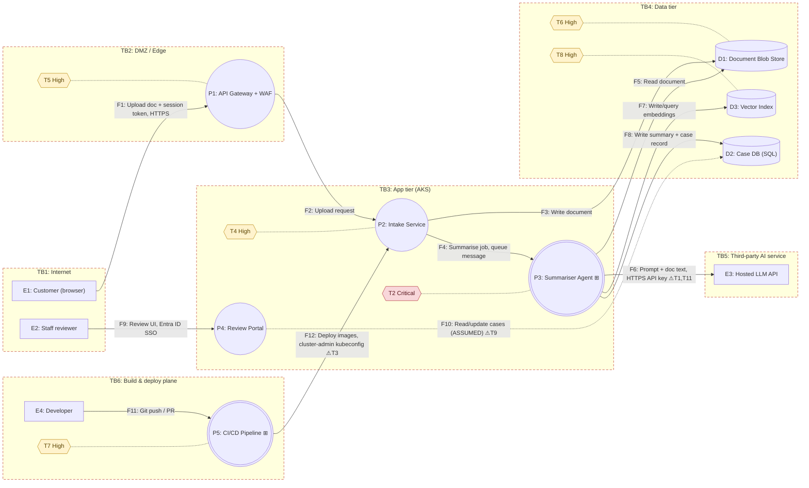
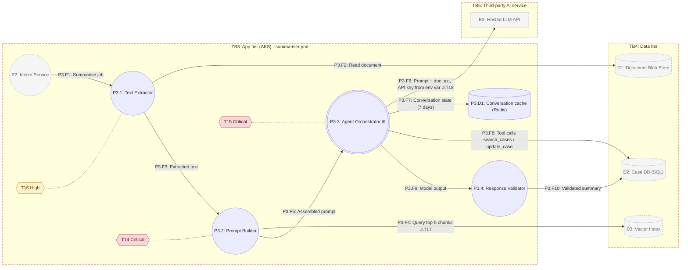
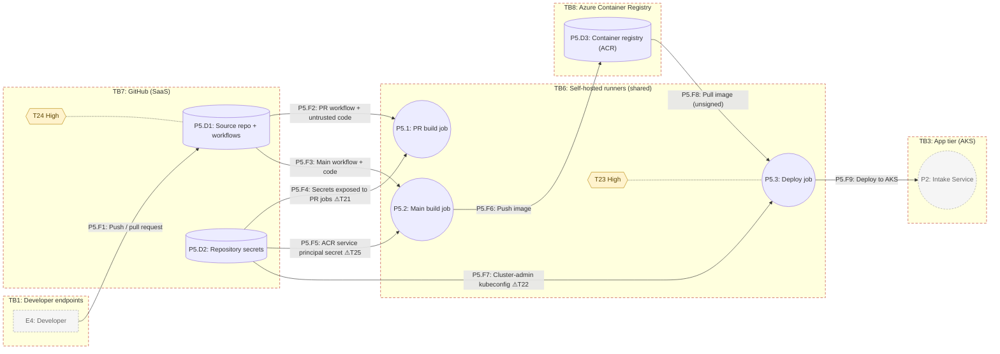
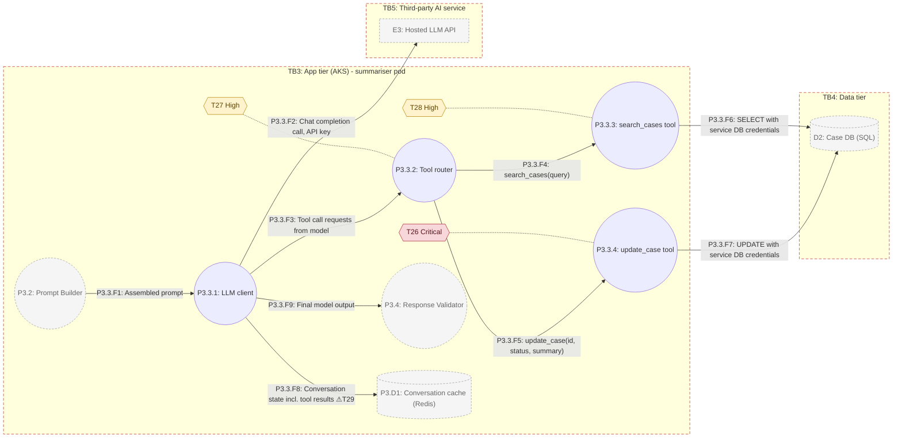
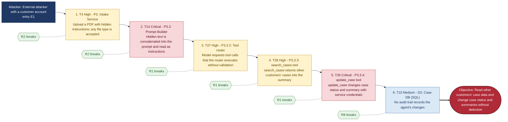
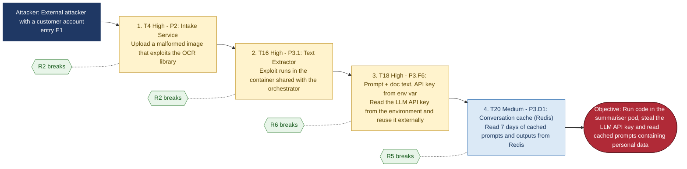
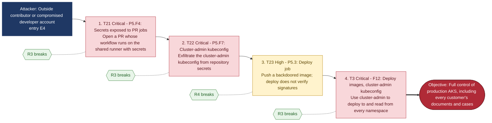

# Threat model - Document Intake & AI Summary Service (example)

## 1. Scope

| Doc | Document | Version | Date | Pages |
|---|---|---|---|---|
| DOC1 | Document Intake & AI Summary Service - High-Level Design.pdf | 0.9 | 2026-10-02 | 24 |
| DOC2 | Platform CI-CD Pipeline Design.pdf | 2.1 | 2026-07-15 | 12 |

Customers upload documents through an Internet-facing gateway; an AI agent summarises them using a third-party hosted LLM, a vector index and two database tools, and staff approve summaries in a review portal. Build and deployment use GitHub Actions on shared self-hosted runners to AKS.

**Frameworks applied:** STRIDE per element (always); LINDDUN (customer personal data in documents, prompts, index and agent memory); OWASP Top 10:2025 (web services); API Security 2023 (gateway APIs); LLM 2026 and Agentic 2026 (summariser agent, tools, memory, vector index); CI/CD Top 10 (DOC2 pipeline).

**Assumptions:**
- F10 Review Portal to Case DB connection is not described in DOC1 and is modelled as assumed.
- The Service Bus queue between Intake and Summariser is modelled as flow F4.

## 2. Decomposition map

- **L0 System context - Document Intake & AI Summary Service** [DOC1 §3.1-5.2; DOC2 §2.1-3.2] - Decomposed P3 (Table 4 lists four components; Critical threat T2) and P5 (DOC2 describes separate build and deploy jobs; Critical/High threats). P1, P2 and P4 not decomposed: the documents give no internal structure.
  - **L1-P3 Summariser Agent** (decomposes P3) [DOC1 §4.1 p.9 Table 4] - Decomposed P3.3 (tools described in §4.4; Critical threat T15). P3.1, P3.2, P3.4 stop here: single components with no further structure in DOC1.
    - **L2-P3.3 Agent Orchestrator** (decomposes P3.3) [DOC1 §4.4 p.12] - Stop at L2: each tool is a single function; no further structure in DOC1.
  - **L1-P5 CI/CD Pipeline** (decomposes P5) [DOC2 §2.1 p.4; DOC2 §3.1 p.7; DOC2 §3.2 p.8] - Stop at L1: jobs are single workflow definitions; DOC2 gives no further structure.

## 3. Diagrams and threats

Legend: rectangle = external entity, circle = process, double circle ⊞ = decomposed, cylinder = data store, grey dashed = context from another level, red dashed box = trust boundary, dashed line = assumed, hexagon = Critical/High threat, ⚠T# on an arrow = threat on that flow.

### L0 System context - Document Intake & AI Summary Service [DOC1 §3.1-5.2; DOC2 §2.1-3.2]

| ID | Severity | STRIDE | LINDDUN | Target | Problem | Solution | Ref | Refines | Paths |
|---|---|---|---|---|---|---|---|---|---|
| T1 | Critical | I | DD, NC | F6: Prompt + doc text, HTTPS API key | Customer documents sent to third-party LLM | Use an enterprise endpoint with zero data retention and region pinning under a DPA; redact personal data before the prompt; complete a DPIA. | DOC1 §4.3 p.11 | - | - |
| T2 | Critical | E | - | P3: Summariser Agent | Indirect prompt injection via uploaded documents | Treat document text as untrusted data and constrain what the agent can do (see child threats T14, T15). | DOC1 §4.1 p.9 Table 4 | - | - |
| T3 | Critical | E | - | F12: Deploy images, cluster-admin kubeconfig | Cluster-admin credential used for deployment | Workload identity federation (OIDC) with a namespace-scoped deploy role; no static credentials in CI. | DOC2 §3.2 p.8 | - | AP3 |
| T4 | High | T | - | P2: Intake Service | Any file type accepted without content checks | Allow-list file types, enforce size limits, AV/CDR scan before any parsing, fail closed on errors. | DOC1 §3.4 p.7 | - | AP1, AP2 |
| T5 | High | S | - | P1: API Gateway + WAF | Long-lived customer session tokens | Short-lived access tokens with refresh rotation, revocation on logout and password change, MFA for account changes. | DOC1 §3.1 p.6 | - | - |
| T6 | High | I | DD | D1: Document Blob Store | Guessable document paths | Random object keys, per-request ownership checks, SAS tokens scoped to one object with short expiry. | DOC1 §5.2 p.17 | - | - |
| T7 | High | T | - | P5: CI/CD Pipeline | Untrusted pull requests can influence the pipeline | Separate the untrusted PR path from the trusted build and deploy path (see child threats T21, T24). | DOC2 §2.1 p.4 | - | - |
| T8 | High | I | L | D3: Vector Index | Single shared vector index for all customers | Per-tenant namespaces with filters enforced server-side, not in the prompt. | DOC1 §4.5 p.13 | - | - |
| T9 | Medium | I | - | F10: Read/update cases | Review Portal database connection not specified | Managed identity, TLS 1.2+, least-privilege stored procedures. | DOC1 gap; DOC1 §4.6 p.14 | - | - |
| T10 | Medium | R | NR | D2: Case DB (SQL) | No audit trail for case changes | Append-only audit log capturing user and agent identity for every case change. | DOC1 gap; DOC1 §4.6 p.14 | - | AP1 |
| T11 | Medium | D | - | F6: Prompt + doc text, HTTPS API key | No limit on document length sent to the model | Per-tenant quotas, maximum tokens per job, circuit breaker on spend. | DOC1 §4.3 p.11 | - | - |
| T12 | Medium | E | - | P4: Review Portal | Reviewers approve summaries without seeing sources | Show source citations next to the summary; require reviewer attestation; sample QA. | DOC1 §4.6 p.14 | - | - |
| T13 | Low | R | U | E1: Customer (browser) | Customers not told documents are AI-processed | Privacy notice and consent text at upload; record the notice version accepted. | DOC1 gap; DOC1 §3.1 p.6 | - | - |

### L1-P3 Summariser Agent - decomposes P3 [DOC1 §4.1 p.9 Table 4]

| ID | Severity | STRIDE | LINDDUN | Target | Problem | Solution | Ref | Refines | Paths |
|---|---|---|---|---|---|---|---|---|---|
| T14 | Critical | T | - | P3.2: Prompt Builder | Untrusted document text mixed into the system prompt | Spotlighting: wrap untrusted text in delimiters with an explicit data-only instruction; keep system prompt separate; strip instruction-like content. | DOC1 §4.3 p.11 | T2 | AP1 |
| T15 | Critical | E | - | P3.3: Agent Orchestrator | Agent executes write tools with service credentials | Least agency: read-only tools by default; writes become proposals approved in the Review Portal; user-scoped tokens for tool calls (see T26-T28). | DOC1 §4.4 p.12 | T2 | - |
| T16 | High | E | - | P3.1: Text Extractor | Parsers share a container with the orchestrator | Run extraction in a separate sandboxed container with no credentials and no egress; patch parsing libraries from a curated repository. | DOC1 §4.2 p.10 | - | AP2 |
| T17 | High | I | DD | P3.F4: Query top-5 chunks | Retrieval query has no tenant filter | Server-side tenant filter on every query; per-tenant namespaces. | DOC1 §4.3 p.11; DOC1 §4.5 p.13 | T8 | - |
| T18 | High | S | - | P3.F6: Prompt + doc text, API key from env var | LLM API key held in an environment variable | Managed identity or Key Vault reference with rotation; separate key per environment; egress restricted to the LLM endpoint. | DOC1 §4.3 p.11 | - | AP2 |
| T19 | Medium | T | - | P3.4: Response Validator | Validator checks format only | Add grounding checks against source text and block outputs containing instructions or links before writing. | DOC1 §4.1 p.9 Table 4 | - | - |
| T20 | Medium | I | DD | P3.D1: Conversation cache (Redis) | Conversation cache holds document content for 7 days | Minimise cached content, 24-hour TTL, Redis AUTH with TLS, private endpoint. | DOC1 §4.4 p.12 | - | AP2 |

### L1-P5 CI/CD Pipeline - decomposes P5 [DOC2 §2.1 p.4; DOC2 §3.1 p.7; DOC2 §3.2 p.8]

| ID | Severity | STRIDE | LINDDUN | Target | Problem | Solution | Ref | Refines | Paths |
|---|---|---|---|---|---|---|---|---|---|
| T21 | Critical | I | - | P5.F4: Secrets exposed to PR jobs | Repository secrets exposed to pull request jobs | No secrets for PR workflows; ephemeral isolated runners for untrusted code; environment protection rules for secrets. | DOC2 §2.1 p.4 | T7 | AP3 |
| T22 | Critical | E | - | P5.F7: Cluster-admin kubeconfig | Cluster-admin kubeconfig stored as a repository secret | OIDC federation to a namespace-scoped deploy identity; remove the kubeconfig secret. | DOC2 §3.2 p.8 | T3 | AP3 |
| T23 | High | T | - | P5.3: Deploy job | Images deployed without signature verification | Sign images at build (Sigstore or Notation) with SLSA provenance; admission policy in AKS rejects unsigned images. | DOC2 §3.2 p.8 | - | AP3 |
| T24 | High | T | - | P5.D1: Source repo + workflows | Third-party actions referenced by mutable tags | Pin actions by full commit SHA; allow-list approved actions; automated update PRs. | DOC2 §2.3 p.5 | T7 | - |
| T25 | Medium | S | - | P5.F5: ACR service principal secret | Static service principal secret for the registry | OIDC federation for ACR push; scoped push-only role. | DOC2 §3.1 p.7 | - | - |

### L2-P3.3 Agent Orchestrator - decomposes P3.3 [DOC1 §4.4 p.12]

| ID | Severity | STRIDE | LINDDUN | Target | Problem | Solution | Ref | Refines | Paths |
|---|---|---|---|---|---|---|---|---|---|
| T26 | Critical | E | - | P3.3.4: update_case tool | update_case can change any case without approval | Replace with propose_case_update limited to the current case ID; the reviewer approves in the Review Portal. | DOC1 §4.4 p.12 | T15 | AP1 |
| T27 | High | T | - | P3.3.2: Tool router | Tool router executes model requests without validation | Allow-list tools per job type; schema-validate and bound every parameter; log every tool call with the job ID. | DOC1 §4.1 p.9 Table 4 | T15 | AP1 |
| T28 | High | I | DD | P3.3.3: search_cases tool | search_cases is not scoped to the customer | Scope search_cases to the current customer using a user-scoped token or row-level security. | DOC1 §4.4 p.12 | T15 | AP1 |
| T29 | Medium | I | DD, L | P3.3.F8: Conversation state incl. tool results | Tool results persisted in conversation memory | Do not persist tool results; partition memory per case; 24-hour TTL. | DOC1 §4.4 p.12 | T20 | - |

## 4. Threat summary

| Diagram | Critical | High | Medium | Low |
|---|---|---|---|---|
| L0 | 3 | 5 | 4 | 1 |
| L1-P3 | 2 | 3 | 2 | 0 |
| L1-P5 | 2 | 2 | 1 | 0 |
| L2-P3.3 | 1 | 2 | 1 | 0 |
| **Total** | 8 | 12 | 8 | 1 |

**Privacy (LINDDUN):**

| Category | Threats |
|---|---|
| L Linking | T8, T29 |
| I Identifying | none found |
| NR Non-repudiation | T10 |
| DT Detecting | none found |
| DD Data disclosure | T1, T6, T17, T20, T28, T29 |
| U Unawareness | T13 |
| NC Non-compliance | T1 |

## 5. Attack paths

| ID | Severity | Attack path | Actor | Steps | Broken by |
|---|---|---|---|---|---|
| AP1 | Critical | Poisoned upload hijacks the agent to read and alter other customers' cases | External attacker with a customer account | T4 → T14 → T27 → T28 → T26 → T10 | R1, R2, R8 |
| AP2 | High | Parser exploit steals the LLM API key and cached customer data | External attacker with a customer account | T4 → T16 → T18 → T20 | R2, R5, R6 |
| AP3 | Critical | Malicious pull request takes over the production cluster | Outside contributor or compromised developer account | T21 → T22 → T23 → T3 | R3, R4 |

### AP1 Poisoned upload hijacks the agent to read and alter other customers' cases (Critical, L4 x I5)

**Actor:** External attacker with a customer account (entry E1). **Objective:** Read other customers' case data and change case status and summaries without detection

| Step | Threat | Diagram | Target | Attacker action | Broken by | Ref |
|---|---|---|---|---|---|---|
| 1 | T4 High | L0 | P2: Intake Service | Upload a PDF with hidden instructions; any file type is accepted | R2 | DOC1 §3.4 p.7 |
| 2 | T14 Critical | L1-P3 | P3.2: Prompt Builder | Hidden text is concatenated into the prompt and read as instructions | R2 | DOC1 §4.3 p.11 |
| 3 | T27 High | L2-P3.3 | P3.3.2: Tool router | Model requests tool calls that the router executes without validation | R1 | DOC1 §4.1 p.9 Table 4 |
| 4 | T28 High | L2-P3.3 | P3.3.3: search_cases tool | search_cases returns other customers' cases into the summary | R1 | DOC1 §4.4 p.12 |
| 5 | T26 Critical | L2-P3.3 | P3.3.4: update_case tool | update_case changes case status and summary with service credentials | R1 | DOC1 §4.4 p.12 |
| 6 | T10 Medium | L0 | D2: Case DB (SQL) | No audit trail records the agent's changes | R8 | DOC1 gap; DOC1 §4.6 p.14 |

### AP2 Parser exploit steals the LLM API key and cached customer data (High, L3 x I5)

**Actor:** External attacker with a customer account (entry E1). **Objective:** Run code in the summariser pod, steal the LLM API key and read cached prompts containing personal data

| Step | Threat | Diagram | Target | Attacker action | Broken by | Ref |
|---|---|---|---|---|---|---|
| 1 | T4 High | L0 | P2: Intake Service | Upload a malformed image that exploits the OCR library | R2 | DOC1 §3.4 p.7 |
| 2 | T16 High | L1-P3 | P3.1: Text Extractor | Exploit runs in the container shared with the orchestrator | R2 | DOC1 §4.2 p.10 |
| 3 | T18 High | L1-P3 | P3.F6: Prompt + doc text, API key from env var | Read the LLM API key from the environment and reuse it externally | R6 | DOC1 §4.3 p.11 |
| 4 | T20 Medium | L1-P3 | P3.D1: Conversation cache (Redis) | Read 7 days of cached prompts and outputs from Redis | R5 | DOC1 §4.4 p.12 |

### AP3 Malicious pull request takes over the production cluster (Critical, L4 x I5)

**Actor:** Outside contributor or compromised developer account (entry E4). **Objective:** Full control of production AKS, including every customer's documents and cases

| Step | Threat | Diagram | Target | Attacker action | Broken by | Ref |
|---|---|---|---|---|---|---|
| 1 | T21 Critical | L1-P5 | P5.F4: Secrets exposed to PR jobs | Open a PR whose workflow runs on the shared runner with secrets | R3 | DOC2 §2.1 p.4 |
| 2 | T22 Critical | L1-P5 | P5.F7: Cluster-admin kubeconfig | Exfiltrate the cluster-admin kubeconfig from repository secrets | R3 | DOC2 §3.2 p.8 |
| 3 | T23 High | L1-P5 | P5.3: Deploy job | Push a backdoored image; deploy does not verify signatures | R4 | DOC2 §3.2 p.8 |
| 4 | T3 Critical | L0 | F12: Deploy images, cluster-admin kubeconfig | Use cluster-admin to deploy to and read from every namespace | R3 | DOC2 §3.2 p.8 |

## 6. Review findings

- Coverage: every Critical/High threat on a decomposed element is refined in its child (T2 by T14 and T15; T7 by T21 and T24; T15 by T26-T28). All Critical and High threats are addressed by an improvement. All gap threats (T9, T10, T13) have questions.
- Pattern - untrusted content reaches privileged components: crafted uploads (T4) reach parsers sharing a container with the orchestrator (T16), are mixed into the prompt (T14) and can drive write tools (T26). R1 + R2 break the chain (AP1, AP2).
- Pattern - static, over-privileged credentials: cluster-admin kubeconfig (T3, T22), registry secret (T25) and LLM API key (T18). R3 and R6 move to workload identity (AP2, AP3).
- Pattern - shared stores without tenant partitioning: blob paths (T6), vector index (T8, T17), search tool (T28) and agent memory (T29). R5 applies one tenant-isolation model.

## 7. Architecture improvements

| ID | Priority | Improvement | Addresses | Attack paths broken | Ref |
|---|---|---|---|---|---|
| R1 | P1 | **Least-agency design for the summariser agent** - Read-only tools by default; replace update_case with propose_case_update limited to the current case and approved by a reviewer; user-scoped tokens and row-level security for tool calls; tool allow-list and parameter validation in the router. | T2, T15, T26, T27, T28 | AP1 | DOC1 §4.4 p.12 |
| R2 | P1 | **Isolate untrusted content processing** - AV/CDR scan and type allow-list at intake; run text extraction in a separate sandboxed container with no credentials or egress; spotlight untrusted text in prompts. | T4, T14, T16 | AP1, AP2 | DOC1 §3.4 p.7; DOC1 §4.2 p.10; DOC1 §4.3 p.11 |
| R3 | P1 | **Keyless, least-privilege pipeline** - OIDC workload identity federation for ACR and AKS with namespace-scoped roles; remove repository secrets; isolated ephemeral runners with no secrets for PRs; pin actions by SHA. | T3, T7, T21, T22, T24, T25 | AP3 | DOC2 §2.1 p.4; DOC2 §3.2 p.8 |
| R4 | P2 | **Signed and verified artifacts** - Sign images and attach SLSA provenance at build; enforce signature verification with an AKS admission policy. | T23 | AP3 | DOC2 §3.2 p.8 |
| R5 | P1 | **Tenant isolation for documents, retrieval and agent memory** - Random blob keys with ownership checks; per-tenant vector namespaces with server-side filters; per-case agent memory with short TTL and no stored tool results. | T6, T8, T17, T20, T29 | AP2 | DOC1 §5.2 p.17; DOC1 §4.5 p.13; DOC1 §4.4 p.12 |
| R6 | P1 | **Governed use of the third-party LLM** - Enterprise endpoint with zero retention and region pinning under a DPA and DPIA; personal data redaction; key held in Key Vault or replaced by managed identity; token quotas; customer notice at upload. | T1, T11, T13, T18 | AP2 | DOC1 §4.3 p.11 |
| R7 | P3 | **Session hardening at the edge** - Short-lived access tokens with refresh rotation and revocation. | T5 | - | DOC1 §3.1 p.6 |
| R8 | P2 | **Accountable human review** - Append-only audit log of case changes with user and agent identity; show sources beside summaries; grounding checks before write. | T10, T12, T19 | AP1 | DOC1 §4.6 p.14 |

## 8. Open questions

| ID | Question | Ask | Ref | Threats |
|---|---|---|---|---|
| Q1 | How does the Review Portal authenticate to the Case DB, and is TLS enforced? | Solution architect | DOC1 §4.6 p.14 | T9 |
| Q2 | Where are case changes and summary approvals audited, and who can alter the audit records? | Solution architect | DOC1 §4.6 p.14 | T10 |
| Q3 | What notice do customers receive that documents are processed by AI and a third-party provider? | Product owner / DPO | DOC1 §3.1 p.6 | T13 |
| Q4 | What data processing terms, region and retention settings apply to the hosted LLM API? | Procurement / DPO | DOC1 §4.3 p.11 | T1 |
| Q5 | Is the Redis cache encrypted, network-isolated and protected with authentication? | Platform team | DOC1 §4.4 p.12 | T20, T29 |
| Q6 | Are the self-hosted runners ephemeral, and which workflows can read which secrets? | Platform team | DOC2 §2.1 p.4 | T21 |
