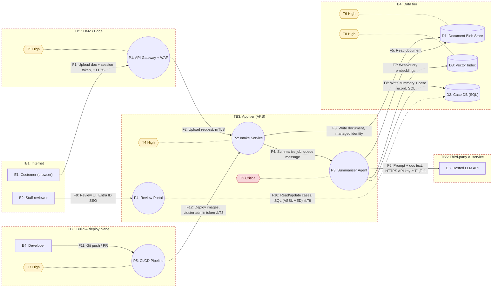

# TM-04 How to use this example

This is the target structure and depth for every answer. The system is fictional. Reuse the structure, ID scheme, threat wording style and level of detail; do not copy its threats into other models unless the spec supports them.

# TM-04 Example input (spec excerpt)

Document Intake & AI Summary Service, spec v0.9.

- §3.1 Customers sign in to the web portal and receive a session token. Uploads go through the API Gateway with WAF.
- §3.4 The Intake Service accepts any file type up to 100 MB, stores it in Blob Storage under /cases/<case-number>/ and puts a job on a queue.
- §4.2 The Summariser Agent reads the document, extracts text and builds a prompt.
- §4.3 The prompt and full document text are sent to a hosted LLM API using an API key. No limit on document length.
- §4.4 Chunks are embedded into a single shared vector index to support follow-up questions.
- §4.5 The summary and case record are written to the Case DB. Staff reviewers sign in to the Review Portal with Entra ID SSO and approve the summary.
- §5.2 Blob paths use the sequential case number.
- §6.1 Developers raise PRs to GitHub; GitHub Actions builds images and deploys to AKS using a cluster-admin token stored as a repository secret. PR builds run on the same runners. Marketplace actions are referenced by tag.

# TM-04 Example output

## 1. Scope

System: Document Intake & AI Summary Service, spec v0.9. Customers upload documents through an Internet-facing gateway; an AI agent summarises them using a third-party hosted LLM and a vector index, and staff approve summaries in a review portal. Deployment is by GitHub Actions to AKS.

Frameworks applied: STRIDE per element (always); LINDDUN (customer personal data in documents); OWASP Top 10:2025 (web portal and services); API Security 2023 (gateway APIs); LLM 2026 and Agentic 2026 (summariser agent, hosted LLM, vector index); CI/CD Top 10 (GitHub Actions pipeline).

Assumptions: F10 Review Portal to Case DB connection is not described (modelled as assumed). Queue between Intake and Summariser modelled as flow F4 for simplicity.

## 2. DFD



## 3. Legend

Rectangle = external entity, circle = process, cylinder = data store, red dashed box = trust boundary, dashed line = assumed, hexagon = Critical/High threat, ⚠T# on an arrow = threat on that flow.

## 4. Downloads

threat_model.drawio (editable diagram) and threat_model_register.xlsx (full register with Status column), produced by tm_generator.py.

## 5. Threat summary

Critical 3 | High 5 | Medium 4 | Low 1 | Total 13

| ID | Severity | STRIDE | Target | Threat | Framework IDs | Control |
|---|---|---|---|---|---|---|
| T1 | Critical | I | F6 | Customer documents sent to third-party LLM without data agreement | LLM02:2026; LINDDUN DD; CWE-201 | Use tenant-hosted model or contract zero-retention + region pinning; redact PII before prompt; DPIA. |
| T2 | Critical | E | P3 | Indirect prompt injection in uploaded documents hijacks summariser | LLM01:2026; ASI01; ASI02 | Treat document text as data (spotlighting/delimiting); least-privilege tool scopes; no direct DB writes from model output without validation; human approval for case status changes. |
| T3 | Critical | E | F12 | Long-lived cluster-admin token in pipeline | CICD-SEC-6; CICD-SEC-5; A08:2025 | Workload identity federation (OIDC) with namespace-scoped deploy role; no static secrets in CI. |
| T4 | High | T | P2 | Malicious file upload processed without content validation | A05:2025; A10:2025; CWE-434 | Allow-list types, size limits, AV/CDR scan in sandbox before parse, fail closed on parser errors. |
| T5 | High | S | P1 | Customer session token weaknesses at gateway | API2:2023; A07:2025 | Short-lived tokens, refresh rotation, revocation list, MFA for account changes. |
| T6 | High | I | D1 | Document IDs guessable across customers | A01:2025; API1:2023; LINDDUN DD | Random object keys; per-request ownership check; SAS scoped to single object with short expiry. |
| T7 | High | T | P5 | Poisoned pipeline execution from PR workflows | CICD-SEC-4; CICD-SEC-3; A03:2025 | Separate untrusted PR runners without secrets; pin actions by SHA; SLSA provenance + signature verification at admission. |
| T8 | High | I | D3 | Vector index shared across customers | LLM09:2026; LINDDUN L | Per-tenant namespaces with filter enforced server-side, not by prompt. |

## 6. Open questions for the spec author

1. How does the Review Portal authenticate to the Case DB, and is TLS enforced? (T9)
2. Where are case changes and summary approvals audited, and who can alter the audit records? (T10)
3. What notice do customers receive that documents are processed by AI and a third-party provider? (T13)
4. What data processing terms, region and retention settings apply to the hosted LLM API? (T1)
5. Is the vector index partitioned per customer, and where is the filter enforced? (T8)

# TM-04 Example JSON model (input to tm_generator.py)

```json
{
 "title": "Threat model - Document Intake & AI Summary Service (example)",
 "boundaries": [
  {
   "id": "TB1",
   "name": "Internet"
  },
  {
   "id": "TB2",
   "name": "DMZ / Edge"
  },
  {
   "id": "TB3",
   "name": "App tier (AKS)"
  },
  {
   "id": "TB4",
   "name": "Data tier"
  },
  {
   "id": "TB5",
   "name": "Third-party AI service"
  },
  {
   "id": "TB6",
   "name": "Build & deploy plane"
  }
 ],
 "elements": [
  {
   "id": "E1",
   "type": "external",
   "name": "Customer (browser)",
   "boundary": "TB1"
  },
  {
   "id": "E2",
   "type": "external",
   "name": "Staff reviewer",
   "boundary": "TB1"
  },
  {
   "id": "P1",
   "type": "process",
   "name": "API Gateway + WAF",
   "boundary": "TB2"
  },
  {
   "id": "P2",
   "type": "process",
   "name": "Intake Service",
   "boundary": "TB3"
  },
  {
   "id": "P3",
   "type": "process",
   "name": "Summariser Agent",
   "boundary": "TB3"
  },
  {
   "id": "P4",
   "type": "process",
   "name": "Review Portal",
   "boundary": "TB3"
  },
  {
   "id": "D1",
   "type": "store",
   "name": "Document Blob Store",
   "boundary": "TB4"
  },
  {
   "id": "D2",
   "type": "store",
   "name": "Case DB (SQL)",
   "boundary": "TB4"
  },
  {
   "id": "D3",
   "type": "store",
   "name": "Vector Index",
   "boundary": "TB4"
  },
  {
   "id": "E3",
   "type": "external",
   "name": "Hosted LLM API",
   "boundary": "TB5"
  },
  {
   "id": "E4",
   "type": "external",
   "name": "Developer",
   "boundary": "TB6"
  },
  {
   "id": "P5",
   "type": "process",
   "name": "CI/CD Pipeline",
   "boundary": "TB6"
  }
 ],
 "flows": [
  {
   "id": "F1",
   "from": "E1",
   "to": "P1",
   "label": "Upload doc + session token, HTTPS"
  },
  {
   "id": "F2",
   "from": "P1",
   "to": "P2",
   "label": "Upload request, mTLS"
  },
  {
   "id": "F3",
   "from": "P2",
   "to": "D1",
   "label": "Write document, managed identity"
  },
  {
   "id": "F4",
   "from": "P2",
   "to": "P3",
   "label": "Summarise job, queue message"
  },
  {
   "id": "F5",
   "from": "P3",
   "to": "D1",
   "label": "Read document"
  },
  {
   "id": "F6",
   "from": "P3",
   "to": "E3",
   "label": "Prompt + doc text, HTTPS API key"
  },
  {
   "id": "F7",
   "from": "P3",
   "to": "D3",
   "label": "Write/query embeddings"
  },
  {
   "id": "F8",
   "from": "P3",
   "to": "D2",
   "label": "Write summary + case record, SQL"
  },
  {
   "id": "F9",
   "from": "E2",
   "to": "P4",
   "label": "Review UI, Entra ID SSO"
  },
  {
   "id": "F10",
   "from": "P4",
   "to": "D2",
   "label": "Read/update cases, SQL",
   "assumed": true
  },
  {
   "id": "F11",
   "from": "E4",
   "to": "P5",
   "label": "Git push / PR"
  },
  {
   "id": "F12",
   "from": "P5",
   "to": "P2",
   "label": "Deploy images, cluster admin token"
  }
 ],
 "threats": [
  {
   "id": "T1",
   "target": "F6",
   "severity": "Critical",
   "likelihood": 4,
   "impact": 5,
   "stride": "I",
   "frameworks": "LLM02:2026; LINDDUN DD; CWE-201",
   "title": "Customer documents sent to third-party LLM without data agreement",
   "description": "Full document text including personal data leaves the tenant to the hosted LLM; spec states no data processing terms, residency or retention settings.",
   "spec_ref": "§4.3",
   "control": "Use tenant-hosted model or contract zero-retention + region pinning; redact PII before prompt; DPIA."
  },
  {
   "id": "T2",
   "target": "P3",
   "severity": "Critical",
   "likelihood": 4,
   "impact": 5,
   "stride": "E",
   "frameworks": "LLM01:2026; ASI01; ASI02",
   "title": "Indirect prompt injection in uploaded documents hijacks summariser",
   "description": "Uploaded files are untrusted input to the agent, which also holds write access to the Case DB; injected text can alter case records or summaries.",
   "spec_ref": "§4.2",
   "control": "Treat document text as data (spotlighting/delimiting); least-privilege tool scopes; no direct DB writes from model output without validation; human approval for case status changes."
  },
  {
   "id": "T3",
   "target": "F12",
   "severity": "Critical",
   "likelihood": 4,
   "impact": 5,
   "stride": "E",
   "frameworks": "CICD-SEC-6; CICD-SEC-5; A08:2025",
   "title": "Long-lived cluster-admin token in pipeline",
   "description": "Pipeline deploys with a static cluster-admin token; compromise of any pipeline job yields full cluster control.",
   "spec_ref": "§6.1",
   "control": "Workload identity federation (OIDC) with namespace-scoped deploy role; no static secrets in CI."
  },
  {
   "id": "T4",
   "target": "P2",
   "severity": "High",
   "likelihood": 4,
   "impact": 4,
   "stride": "T",
   "frameworks": "A05:2025; A10:2025; CWE-434",
   "title": "Malicious file upload processed without content validation",
   "description": "Intake accepts any file type up to 100 MB and passes it to parsers; malformed or weaponised files can exploit the parser or exhaust resources.",
   "spec_ref": "§3.4",
   "control": "Allow-list types, size limits, AV/CDR scan in sandbox before parse, fail closed on parser errors."
  },
  {
   "id": "T5",
   "target": "P1",
   "severity": "High",
   "likelihood": 3,
   "impact": 4,
   "stride": "S",
   "frameworks": "API2:2023; A07:2025",
   "title": "Customer session token weaknesses at gateway",
   "description": "Spec does not define token lifetime, binding or revocation for customer sessions.",
   "spec_ref": "§3.1",
   "control": "Short-lived tokens, refresh rotation, revocation list, MFA for account changes."
  },
  {
   "id": "T6",
   "target": "D1",
   "severity": "High",
   "likelihood": 3,
   "impact": 4,
   "stride": "I",
   "frameworks": "A01:2025; API1:2023; LINDDUN DD",
   "title": "Document IDs guessable across customers",
   "description": "Blob paths use sequential case numbers; any service path that accepts a document ID could return another customer's file.",
   "spec_ref": "§5.2",
   "control": "Random object keys; per-request ownership check; SAS scoped to single object with short expiry."
  },
  {
   "id": "T7",
   "target": "P5",
   "severity": "High",
   "likelihood": 3,
   "impact": 4,
   "stride": "T",
   "frameworks": "CICD-SEC-4; CICD-SEC-3; A03:2025",
   "title": "Poisoned pipeline execution from PR workflows",
   "description": "PR builds run with the same runner and secrets as main-branch builds; unpinned third-party actions.",
   "spec_ref": "§6.1",
   "control": "Separate untrusted PR runners without secrets; pin actions by SHA; SLSA provenance + signature verification at admission."
  },
  {
   "id": "T8",
   "target": "D3",
   "severity": "High",
   "likelihood": 3,
   "impact": 4,
   "stride": "I",
   "frameworks": "LLM09:2026; LINDDUN L",
   "title": "Vector index shared across customers",
   "description": "Single index without tenant partitioning; retrieval for one case can surface another customer's content.",
   "spec_ref": "§4.4",
   "control": "Per-tenant namespaces with filter enforced server-side, not by prompt."
  },
  {
   "id": "T9",
   "target": "F10",
   "severity": "Medium",
   "likelihood": 3,
   "impact": 3,
   "stride": "I",
   "frameworks": "A04:2025",
   "title": "Review Portal DB connection not specified",
   "description": "Spec does not state how the portal authenticates to SQL or whether TLS is enforced (flow ASSUMED).",
   "spec_ref": "gap",
   "control": "Managed identity, TLS 1.2+, read/update stored procedures only."
  },
  {
   "id": "T10",
   "target": "D2",
   "severity": "Medium",
   "likelihood": 2,
   "impact": 4,
   "stride": "R",
   "frameworks": "A09:2025; LINDDUN NR",
   "title": "No audit trail for case changes",
   "description": "Spec has no audit log for who changed a case or accepted an AI summary.",
   "spec_ref": "gap",
   "control": "Append-only audit table / immutable log with user and agent identity."
  },
  {
   "id": "T11",
   "target": "F6",
   "severity": "Medium",
   "likelihood": 3,
   "impact": 3,
   "stride": "D",
   "frameworks": "LLM06:2026",
   "title": "Unbounded LLM consumption",
   "description": "No limits on document size or tokens per job; large or adversarial uploads drive cost and throttling.",
   "spec_ref": "§4.3",
   "control": "Per-tenant quotas, max tokens per job, circuit breaker."
  },
  {
   "id": "T12",
   "target": "P4",
   "severity": "Medium",
   "likelihood": 2,
   "impact": 3,
   "stride": "E",
   "frameworks": "A01:2025; ASI09",
   "title": "Reviewers can approve AI summaries without seeing source",
   "description": "UI shows summary only; over-reliance can push incorrect outcomes into the case record.",
   "spec_ref": "§4.5",
   "control": "Show source citations; require reviewer attestation; sample QA."
  },
  {
   "id": "T13",
   "target": "E1",
   "severity": "Low",
   "likelihood": 2,
   "impact": 2,
   "stride": "R",
   "frameworks": "LINDDUN U",
   "title": "Customers not told documents are AI-processed",
   "description": "No notice in upload flow about AI processing or third-party transfer.",
   "spec_ref": "gap",
   "control": "Privacy notice and consent text at upload; record notice version."
  }
 ]
}
```
