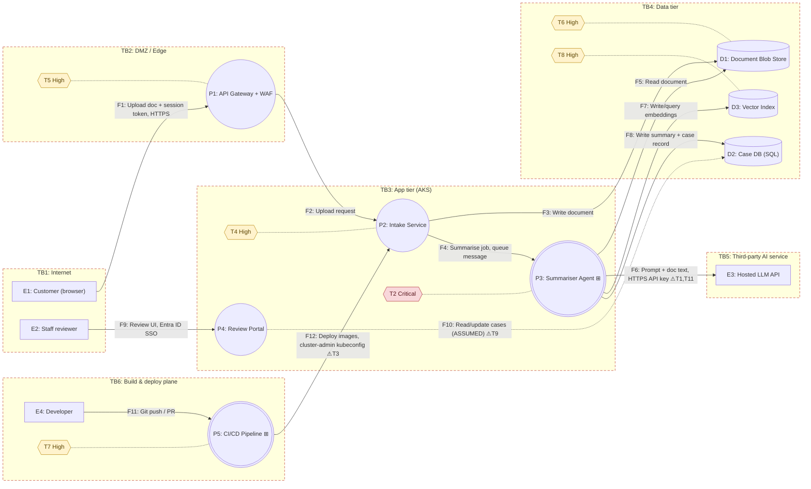
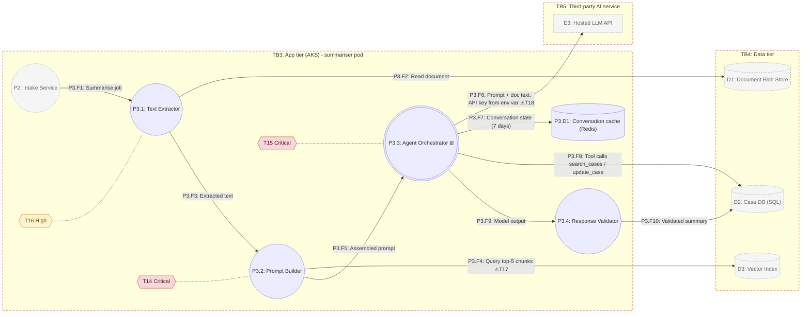
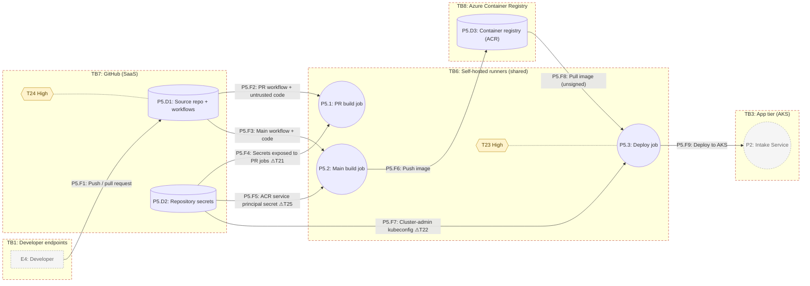
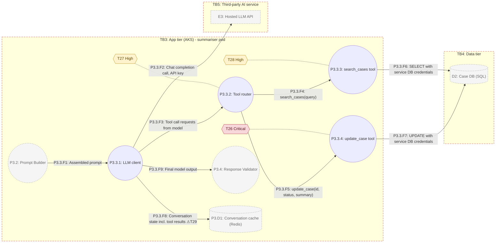

# TM-04 How to use this example

This is the target structure, depth and referencing for every answer. The system and documents are fictional. Reuse the structure, ID scheme, decomposition decisions, reference style and wording; do not copy its threats into other models unless the documents support them.

# TM-04 Example input documents

The worked example uses two fictional design documents. Page numbers are shown as [p.N].

## DOC1 - Document Intake & AI Summary Service - High-Level Design, v0.9, 2 Oct 2026 (24 pages)

**§3.1 Customer access [p.6]**
Customers sign in to the web portal and receive a session token valid for 24 hours. All uploads go through the API Gateway with WAF.

**§3.4 Document intake [p.7]**
The Intake Service accepts any file type up to 100 MB. Files are stored in Blob Storage under /cases/<case-number>/ and a job is posted to a Service Bus queue.

**§4.1 Summariser overview [p.9]**
The Summariser Agent is composed of four components (Table 4).

Table 4 - Summariser components [p.9]

| Component | Function |
|---|---|
| Text Extractor | Parses PDF, DOCX and images (OCR) into plain text |
| Prompt Builder | Assembles the prompt and retrieves context from the vector index |
| Agent Orchestrator | Calls the LLM and executes the tool calls it requests |
| Response Validator | Checks the summary against the JSON schema |

**§4.2 Text extraction [p.10]**
The Text Extractor runs in the same container as the Agent Orchestrator and uses open-source parsing libraries; OCR uses Tesseract.

**§4.3 Prompt construction and model access [p.11]**
The Prompt Builder concatenates the system prompt, document text and top-5 retrieved chunks into one prompt. The prompt and full document text are sent to the hosted LLM API using an API key stored in an environment variable. There is no limit on document length.

**§4.4 Agent tools [p.12]**
The Orchestrator exposes two tools to the model: search_cases (reads the Case DB) and update_case (writes case status and summary). Tool calls are executed with the service's database credentials. Conversation state is cached in Redis for 7 days.

**§4.5 Retrieval [p.13]**
Document chunks are embedded into a single shared vector index to support follow-up questions.

**§4.6 Review [p.14]**
The summary and case record are written to the Case DB. Staff reviewers sign in to the Review Portal with Entra ID SSO and approve the summary.

**§5.2 Storage layout [p.17]**
Blob paths use the sequential case number.

## DOC2 - Platform CI/CD Pipeline Design, v2.1, 15 Jul 2026 (12 pages)

**§2.1 Source control [p.4]**
Developers raise pull requests in GitHub. PR builds run on the shared self-hosted runners used for main-branch builds, with access to repository secrets.

**§2.3 Workflow dependencies [p.5]**
Workflows reference marketplace actions by tag.

**§3.1 Build [p.7]**
The build job builds container images and pushes them to Azure Container Registry using a service principal secret.

**§3.2 Deploy [p.8]**
The deploy job uses a cluster-admin kubeconfig stored as a repository secret to deploy to AKS. Image signatures are not verified at deployment.

# TM-04 Example output

## 1. Scope

| Doc | Document | Version | Pages |
|---|---|---|---|
| DOC1 | Document Intake & AI Summary Service - High-Level Design.pdf | 0.9 | 24 |
| DOC2 | Platform CI-CD Pipeline Design.pdf | 2.1 | 12 |

System: customers upload documents through an Internet-facing gateway; an AI agent summarises them using a third-party hosted LLM, a vector index and two database tools, and staff approve summaries in a review portal. Build and deployment use GitHub Actions on shared self-hosted runners to AKS.

Frameworks applied: STRIDE per element (always); LINDDUN (customer personal data); OWASP Top 10:2025 (web services); API Security 2023 (gateway APIs); LLM 2026 and Agentic 2026 (summariser agent, tools, memory, vector index); CI/CD Top 10 (DOC2 pipeline).

Assumptions: F10 Review Portal to Case DB connection is not described in DOC1 and is modelled as assumed.

## 2. Decomposition map

- L0 System context - Document Intake & AI Summary Service [DOC1 §3.1-5.2; DOC2 §2.1-3.2]: Decomposed P3 (Table 4 lists four components; Critical threat T2) and P5 (DOC2 describes separate build and deploy jobs; Critical/High threats). P1, P2 and P4 not decomposed: the documents give no internal structure.
    - L1-P3 Summariser Agent (decomposes P3) [DOC1 §4.1 p.9 Table 4]: Decomposed P3.3 (tools described in §4.4; Critical threat T15). P3.1, P3.2, P3.4 stop here: single components with no further structure in DOC1.
        - L2-P3.3 Agent Orchestrator (decomposes P3.3) [DOC1 §4.4 p.12]: Stop at L2: each tool is a single function; no further structure in DOC1.
    - L1-P5 CI/CD Pipeline (decomposes P5) [DOC2 §2.1 p.4; DOC2 §3.1 p.7; DOC2 §3.2 p.8]: Stop at L1: jobs are single workflow definitions; DOC2 gives no further structure.

## 3. Diagrams

Legend: rectangle = external entity, circle = process, double circle ⊞ = decomposed (see child diagram), cylinder = data store, grey dashed = context from another level, red dashed box = trust boundary, dashed line = assumed, hexagon = Critical/High threat, ⚠T# on an arrow = threat on that flow.

## L0 System context - Document Intake & AI Summary Service [DOC1 §3.1-5.2; DOC2 §2.1-3.2]



## L1-P3 Summariser Agent - decomposes P3 [DOC1 §4.1 p.9 Table 4]



## L1-P5 CI/CD Pipeline - decomposes P5 [DOC2 §2.1 p.4; DOC2 §3.1 p.7; DOC2 §3.2 p.8]



## L2-P3.3 Agent Orchestrator - decomposes P3.3 [DOC1 §4.4 p.12]



## 4. Threat summary

| Diagram | Level | Critical | High | Medium | Low |
|---|---|---|---|---|---|
| L0 | L0 | 3 | 5 | 4 | 1 |
| L1-P3 | L1 | 2 | 3 | 2 | 0 |
| L1-P5 | L1 | 2 | 2 | 1 | 0 |
| L2-P3.3 | L2 | 1 | 2 | 1 | 0 |

| ID | Diagram | Target | Severity | Problem | Solution | Ref | Refines / Refined by |
|---|---|---|---|---|---|---|---|
| T1 | L0 | F6: Prompt + doc text, HTTPS API key | Critical | Customer documents sent to third-party LLM | Use an enterprise endpoint with zero data retention and region pinning under a DPA; redact personal data before the prompt; complete a DPIA. | DOC1 §4.3 p.11 | - / - |
| T2 | L0 | P3: Summariser Agent | Critical | Indirect prompt injection via uploaded documents | Treat document text as untrusted data and constrain what the agent can do (see child threats T14, T15). | DOC1 §4.1 p.9 Table 4 | - / T14, T15 |
| T3 | L0 | F12: Deploy images, cluster-admin kubeconfig | Critical | Cluster-admin credential used for deployment | Workload identity federation (OIDC) with a namespace-scoped deploy role; no static credentials in CI. | DOC2 §3.2 p.8 | - / T22 |
| T4 | L0 | P2: Intake Service | High | Any file type accepted without content checks | Allow-list file types, enforce size limits, AV/CDR scan before any parsing, fail closed on errors. | DOC1 §3.4 p.7 | - / - |
| T5 | L0 | P1: API Gateway + WAF | High | Long-lived customer session tokens | Short-lived access tokens with refresh rotation, revocation on logout and password change, MFA for account changes. | DOC1 §3.1 p.6 | - / - |
| T6 | L0 | D1: Document Blob Store | High | Guessable document paths | Random object keys, per-request ownership checks, SAS tokens scoped to one object with short expiry. | DOC1 §5.2 p.17 | - / - |
| T7 | L0 | P5: CI/CD Pipeline | High | Untrusted pull requests can influence the pipeline | Separate the untrusted PR path from the trusted build and deploy path (see child threats T21, T24). | DOC2 §2.1 p.4 | - / T21, T24 |
| T8 | L0 | D3: Vector Index | High | Single shared vector index for all customers | Per-tenant namespaces with filters enforced server-side, not in the prompt. | DOC1 §4.5 p.13 | - / T17 |
| T14 | L1-P3 | P3.2: Prompt Builder | Critical | Untrusted document text mixed into the system prompt | Spotlighting: wrap untrusted text in delimiters with an explicit data-only instruction; keep system prompt separate; strip instruction-like content. | DOC1 §4.3 p.11 | T2 / - |
| T15 | L1-P3 | P3.3: Agent Orchestrator | Critical | Agent executes write tools with service credentials | Least agency: read-only tools by default; writes become proposals approved in the Review Portal; user-scoped tokens for tool calls (see T26-T28). | DOC1 §4.4 p.12 | T2 / T26, T27, T28 |
| T16 | L1-P3 | P3.1: Text Extractor | High | Parsers share a container with the orchestrator | Run extraction in a separate sandboxed container with no credentials and no egress; patch parsing libraries from a curated repository. | DOC1 §4.2 p.10 | - / - |
| T17 | L1-P3 | P3.F4: Query top-5 chunks | High | Retrieval query has no tenant filter | Server-side tenant filter on every query; per-tenant namespaces. | DOC1 §4.3 p.11; DOC1 §4.5 p.13 | T8 / - |
| T18 | L1-P3 | P3.F6: Prompt + doc text, API key from env var | High | LLM API key held in an environment variable | Managed identity or Key Vault reference with rotation; separate key per environment; egress restricted to the LLM endpoint. | DOC1 §4.3 p.11 | - / - |
| T21 | L1-P5 | P5.F4: Secrets exposed to PR jobs | Critical | Repository secrets exposed to pull request jobs | No secrets for PR workflows; ephemeral isolated runners for untrusted code; environment protection rules for secrets. | DOC2 §2.1 p.4 | T7 / - |
| T22 | L1-P5 | P5.F7: Cluster-admin kubeconfig | Critical | Cluster-admin kubeconfig stored as a repository secret | OIDC federation to a namespace-scoped deploy identity; remove the kubeconfig secret. | DOC2 §3.2 p.8 | T3 / - |
| T23 | L1-P5 | P5.3: Deploy job | High | Images deployed without signature verification | Sign images at build (Sigstore or Notation) with SLSA provenance; admission policy in AKS rejects unsigned images. | DOC2 §3.2 p.8 | - / - |
| T24 | L1-P5 | P5.D1: Source repo + workflows | High | Third-party actions referenced by mutable tags | Pin actions by full commit SHA; allow-list approved actions; automated update PRs. | DOC2 §2.3 p.5 | T7 / - |
| T26 | L2-P3.3 | P3.3.4: update_case tool | Critical | update_case can change any case without approval | Replace with propose_case_update limited to the current case ID; the reviewer approves in the Review Portal. | DOC1 §4.4 p.12 | T15 / - |
| T27 | L2-P3.3 | P3.3.2: Tool router | High | Tool router executes model requests without validation | Allow-list tools per job type; schema-validate and bound every parameter; log every tool call with the job ID. | DOC1 §4.1 p.9 Table 4 | T15 / - |
| T28 | L2-P3.3 | P3.3.3: search_cases tool | High | search_cases is not scoped to the customer | Scope search_cases to the current customer using a user-scoped token or row-level security. | DOC1 §4.4 p.12 | T15 / - |

## 5. Review findings

- Coverage: every Critical/High threat on a decomposed element is refined in its child (T2 by T14 and T15; T7 by T21 and T24; T15 by T26-T28). All Critical and High threats are addressed by an improvement. All gap threats (T9, T10, T13) have questions. Generator warnings: none.
- Cross-level pattern 1 - untrusted content reaches privileged components: crafted uploads (T4) reach parsers that share a container with the orchestrator (T16), are mixed into the prompt (T14) and can drive write tools (T26). One structural change (R1 + R2) addresses the chain.
- Cross-level pattern 2 - static, over-privileged credentials: the cluster-admin kubeconfig (T3, T22), the registry secret (T25) and the LLM API key (T18) are all long-lived secrets. R3 and R6 move to workload identity.
- Cross-level pattern 3 - shared stores without tenant partitioning: blob paths (T6), vector index (T8, T17), search tool (T28) and agent memory (T29). R5 applies one tenant-isolation model across them.

## 6. Architecture improvements

| ID | Priority | Improvement | Addresses | Ref |
|---|---|---|---|---|
| R1 | P1 | Least-agency design for the summariser agent | T2, T15, T26, T27, T28 | DOC1 §4.4 p.12 |
| R2 | P1 | Isolate untrusted content processing | T4, T14, T16 | DOC1 §3.4 p.7; DOC1 §4.2 p.10; DOC1 §4.3 p.11 |
| R3 | P1 | Keyless, least-privilege pipeline | T3, T7, T21, T22, T24, T25 | DOC2 §2.1 p.4; DOC2 §3.2 p.8 |
| R4 | P2 | Signed and verified artifacts | T23 | DOC2 §3.2 p.8 |
| R5 | P1 | Tenant isolation for documents, retrieval and agent memory | T6, T8, T17, T20, T29 | DOC1 §5.2 p.17; DOC1 §4.5 p.13; DOC1 §4.4 p.12 |
| R6 | P1 | Governed use of the third-party LLM | T1, T11, T13, T18 | DOC1 §4.3 p.11 |
| R7 | P3 | Session hardening at the edge | T5 | DOC1 §3.1 p.6 |
| R8 | P2 | Accountable human review | T10, T12, T19 | DOC1 §4.6 p.14 |

## 7. Open questions

| ID | Question | Ref | Threats |
|---|---|---|---|
| Q1 | How does the Review Portal authenticate to the Case DB, and is TLS enforced? | DOC1 §4.6 p.14 | T9 |
| Q2 | Where are case changes and summary approvals audited, and who can alter the audit records? | DOC1 §4.6 p.14 | T10 |
| Q3 | What notice do customers receive that documents are processed by AI and a third-party provider? | DOC1 §3.1 p.6 | T13 |
| Q4 | What data processing terms, region and retention settings apply to the hosted LLM API? | DOC1 §4.3 p.11 | T1 |
| Q5 | Is the Redis cache encrypted, network-isolated and protected with authentication? | DOC1 §4.4 p.12 | T20, T29 |
| Q6 | Are the self-hosted runners ephemeral, and which workflows can read which secrets? | DOC2 §2.1 p.4 | T21 |

## 8. Downloads

example_threat_model.drawio (four pages with drill-down), example_threat_model_register.xlsx (all levels, cross-referenced) and the model JSON, produced by tm_generator.py.

# TM-04 Example JSON model (input to tm_generator.py)

```json
{
 "title": "Threat model - Document Intake & AI Summary Service (example)",
 "documents": [
  {
   "id": "DOC1",
   "name": "Document Intake & AI Summary Service - High-Level Design.pdf",
   "version": "0.9",
   "date": "2026-10-02",
   "pages": 24
  },
  {
   "id": "DOC2",
   "name": "Platform CI-CD Pipeline Design.pdf",
   "version": "2.1",
   "date": "2026-07-15",
   "pages": 12
  }
 ],
 "diagrams": [
  {
   "id": "L0",
   "level": 0,
   "title": "System context - Document Intake & AI Summary Service",
   "refs": [
    {
     "doc": "DOC1",
     "section": "3.1-5.2"
    },
    {
     "doc": "DOC2",
     "section": "2.1-3.2"
    }
   ],
   "stop_reason": "Decomposed P3 (Table 4 lists four components; Critical threat T2) and P5 (DOC2 describes separate build and deploy jobs; Critical/High threats). P1, P2 and P4 not decomposed: the documents give no internal structure.",
   "boundaries": [
    {
     "id": "TB1",
     "name": "Internet"
    },
    {
     "id": "TB2",
     "name": "DMZ / Edge"
    },
    {
     "id": "TB3",
     "name": "App tier (AKS)"
    },
    {
     "id": "TB4",
     "name": "Data tier"
    },
    {
     "id": "TB5",
     "name": "Third-party AI service"
    },
    {
     "id": "TB6",
     "name": "Build & deploy plane"
    }
   ],
   "elements": [
    {
     "id": "E1",
     "type": "external",
     "name": "Customer (browser)",
     "boundary": "TB1",
     "refs": [
      {
       "doc": "DOC1",
       "section": "3.1",
       "page": 6
      }
     ]
    },
    {
     "id": "E2",
     "type": "external",
     "name": "Staff reviewer",
     "boundary": "TB1",
     "refs": [
      {
       "doc": "DOC1",
       "section": "4.6",
       "page": 14
      }
     ]
    },
    {
     "id": "P1",
     "type": "process",
     "name": "API Gateway + WAF",
     "boundary": "TB2",
     "refs": [
      {
       "doc": "DOC1",
       "section": "3.1",
       "page": 6
      }
     ]
    },
    {
     "id": "P2",
     "type": "process",
     "name": "Intake Service",
     "boundary": "TB3",
     "refs": [
      {
       "doc": "DOC1",
       "section": "3.4",
       "page": 7
      }
     ]
    },
    {
     "id": "P3",
     "type": "process",
     "name": "Summariser Agent",
     "boundary": "TB3",
     "refs": [
      {
       "doc": "DOC1",
       "section": "4.1",
       "page": 9,
       "loc": "Table 4"
      }
     ]
    },
    {
     "id": "P4",
     "type": "process",
     "name": "Review Portal",
     "boundary": "TB3",
     "refs": [
      {
       "doc": "DOC1",
       "section": "4.6",
       "page": 14
      }
     ]
    },
    {
     "id": "D1",
     "type": "store",
     "name": "Document Blob Store",
     "boundary": "TB4",
     "refs": [
      {
       "doc": "DOC1",
       "section": "3.4",
       "page": 7
      }
     ]
    },
    {
     "id": "D2",
     "type": "store",
     "name": "Case DB (SQL)",
     "boundary": "TB4",
     "refs": [
      {
       "doc": "DOC1",
       "section": "4.6",
       "page": 14
      }
     ]
    },
    {
     "id": "D3",
     "type": "store",
     "name": "Vector Index",
     "boundary": "TB4",
     "refs": [
      {
       "doc": "DOC1",
       "section": "4.5",
       "page": 13
      }
     ]
    },
    {
     "id": "E3",
     "type": "external",
     "name": "Hosted LLM API",
     "boundary": "TB5",
     "refs": [
      {
       "doc": "DOC1",
       "section": "4.3",
       "page": 11
      }
     ]
    },
    {
     "id": "E4",
     "type": "external",
     "name": "Developer",
     "boundary": "TB6",
     "refs": [
      {
       "doc": "DOC2",
       "section": "2.1",
       "page": 4
      }
     ]
    },
    {
     "id": "P5",
     "type": "process",
     "name": "CI/CD Pipeline",
     "boundary": "TB6",
     "refs": [
      {
       "doc": "DOC2",
       "section": "2.1",
       "page": 4
      }
     ]
    }
   ],
   "flows": [
    {
     "id": "F1",
     "from": "E1",
     "to": "P1",
     "label": "Upload doc + session token, HTTPS",
     "refs": [
      {
       "doc": "DOC1",
       "section": "3.1",
       "page": 6
      }
     ]
    },
    {
     "id": "F2",
     "from": "P1",
     "to": "P2",
     "label": "Upload request",
     "refs": [
      {
       "doc": "DOC1",
       "section": "3.1",
       "page": 6
      }
     ]
    },
    {
     "id": "F3",
     "from": "P2",
     "to": "D1",
     "label": "Write document",
     "refs": [
      {
       "doc": "DOC1",
       "section": "3.4",
       "page": 7
      }
     ]
    },
    {
     "id": "F4",
     "from": "P2",
     "to": "P3",
     "label": "Summarise job, queue message",
     "refs": [
      {
       "doc": "DOC1",
       "section": "3.4",
       "page": 7
      }
     ]
    },
    {
     "id": "F5",
     "from": "P3",
     "to": "D1",
     "label": "Read document",
     "refs": [
      {
       "doc": "DOC1",
       "section": "4.2",
       "page": 10
      }
     ]
    },
    {
     "id": "F6",
     "from": "P3",
     "to": "E3",
     "label": "Prompt + doc text, HTTPS API key",
     "refs": [
      {
       "doc": "DOC1",
       "section": "4.3",
       "page": 11
      }
     ]
    },
    {
     "id": "F7",
     "from": "P3",
     "to": "D3",
     "label": "Write/query embeddings",
     "refs": [
      {
       "doc": "DOC1",
       "section": "4.5",
       "page": 13
      }
     ]
    },
    {
     "id": "F8",
     "from": "P3",
     "to": "D2",
     "label": "Write summary + case record",
     "refs": [
      {
       "doc": "DOC1",
       "section": "4.4",
       "page": 12
      },
      {
       "doc": "DOC1",
       "section": "4.6",
       "page": 14
      }
     ]
    },
    {
     "id": "F9",
     "from": "E2",
     "to": "P4",
     "label": "Review UI, Entra ID SSO",
     "refs": [
      {
       "doc": "DOC1",
       "section": "4.6",
       "page": 14
      }
     ]
    },
    {
     "id": "F10",
     "from": "P4",
     "to": "D2",
     "label": "Read/update cases",
     "refs": [
      {
       "doc": "DOC1",
       "section": "4.6",
       "page": 14
      }
     ],
     "assumed": true
    },
    {
     "id": "F11",
     "from": "E4",
     "to": "P5",
     "label": "Git push / PR",
     "refs": [
      {
       "doc": "DOC2",
       "section": "2.1",
       "page": 4
      }
     ]
    },
    {
     "id": "F12",
     "from": "P5",
     "to": "P2",
     "label": "Deploy images, cluster-admin kubeconfig",
     "refs": [
      {
       "doc": "DOC2",
       "section": "3.2",
       "page": 8
      }
     ]
    }
   ]
  },
  {
   "id": "L1-P3",
   "level": 1,
   "parent": "P3",
   "title": "Summariser Agent",
   "refs": [
    {
     "doc": "DOC1",
     "section": "4.1",
     "page": 9,
     "loc": "Table 4"
    }
   ],
   "stop_reason": "Decomposed P3.3 (tools described in §4.4; Critical threat T15). P3.1, P3.2, P3.4 stop here: single components with no further structure in DOC1.",
   "boundaries": [
    {
     "id": "TB3",
     "name": "App tier (AKS) - summariser pod"
    },
    {
     "id": "TB4",
     "name": "Data tier"
    },
    {
     "id": "TB5",
     "name": "Third-party AI service"
    }
   ],
   "elements": [
    {
     "id": "P2",
     "type": "process",
     "name": "Intake Service",
     "boundary": "TB3",
     "context": true
    },
    {
     "id": "P3.1",
     "type": "process",
     "name": "Text Extractor",
     "boundary": "TB3",
     "refs": [
      {
       "doc": "DOC1",
       "section": "4.1",
       "page": 9,
       "loc": "Table 4"
      },
      {
       "doc": "DOC1",
       "section": "4.2",
       "page": 10
      }
     ]
    },
    {
     "id": "P3.2",
     "type": "process",
     "name": "Prompt Builder",
     "boundary": "TB3",
     "refs": [
      {
       "doc": "DOC1",
       "section": "4.1",
       "page": 9,
       "loc": "Table 4"
      },
      {
       "doc": "DOC1",
       "section": "4.3",
       "page": 11
      }
     ]
    },
    {
     "id": "P3.3",
     "type": "process",
     "name": "Agent Orchestrator",
     "boundary": "TB3",
     "refs": [
      {
       "doc": "DOC1",
       "section": "4.1",
       "page": 9,
       "loc": "Table 4"
      },
      {
       "doc": "DOC1",
       "section": "4.4",
       "page": 12
      }
     ]
    },
    {
     "id": "P3.4",
     "type": "process",
     "name": "Response Validator",
     "boundary": "TB3",
     "refs": [
      {
       "doc": "DOC1",
       "section": "4.1",
       "page": 9,
       "loc": "Table 4"
      }
     ]
    },
    {
     "id": "P3.D1",
     "type": "store",
     "name": "Conversation cache (Redis)",
     "boundary": "TB3",
     "refs": [
      {
       "doc": "DOC1",
       "section": "4.4",
       "page": 12
      }
     ]
    },
    {
     "id": "D1",
     "type": "store",
     "name": "Document Blob Store",
     "boundary": "TB4",
     "context": true
    },
    {
     "id": "D3",
     "type": "store",
     "name": "Vector Index",
     "boundary": "TB4",
     "context": true
    },
    {
     "id": "D2",
     "type": "store",
     "name": "Case DB (SQL)",
     "boundary": "TB4",
     "context": true
    },
    {
     "id": "E3",
     "type": "external",
     "name": "Hosted LLM API",
     "boundary": "TB5",
     "context": true
    }
   ],
   "flows": [
    {
     "id": "P3.F1",
     "from": "P2",
     "to": "P3.1",
     "label": "Summarise job",
     "refs": [
      {
       "doc": "DOC1",
       "section": "3.4",
       "page": 7
      }
     ],
     "parent": "F4"
    },
    {
     "id": "P3.F2",
     "from": "P3.1",
     "to": "D1",
     "label": "Read document",
     "refs": [
      {
       "doc": "DOC1",
       "section": "4.2",
       "page": 10
      }
     ],
     "parent": "F5"
    },
    {
     "id": "P3.F3",
     "from": "P3.1",
     "to": "P3.2",
     "label": "Extracted text",
     "refs": [
      {
       "doc": "DOC1",
       "section": "4.1",
       "page": 9,
       "loc": "Table 4"
      }
     ]
    },
    {
     "id": "P3.F4",
     "from": "P3.2",
     "to": "D3",
     "label": "Query top-5 chunks",
     "refs": [
      {
       "doc": "DOC1",
       "section": "4.3",
       "page": 11
      },
      {
       "doc": "DOC1",
       "section": "4.5",
       "page": 13
      }
     ],
     "parent": "F7"
    },
    {
     "id": "P3.F5",
     "from": "P3.2",
     "to": "P3.3",
     "label": "Assembled prompt",
     "refs": [
      {
       "doc": "DOC1",
       "section": "4.3",
       "page": 11
      }
     ]
    },
    {
     "id": "P3.F6",
     "from": "P3.3",
     "to": "E3",
     "label": "Prompt + doc text, API key from env var",
     "refs": [
      {
       "doc": "DOC1",
       "section": "4.3",
       "page": 11
      }
     ],
     "parent": "F6"
    },
    {
     "id": "P3.F7",
     "from": "P3.3",
     "to": "P3.D1",
     "label": "Conversation state (7 days)",
     "refs": [
      {
       "doc": "DOC1",
       "section": "4.4",
       "page": 12
      }
     ]
    },
    {
     "id": "P3.F8",
     "from": "P3.3",
     "to": "D2",
     "label": "Tool calls search_cases / update_case",
     "refs": [
      {
       "doc": "DOC1",
       "section": "4.4",
       "page": 12
      }
     ],
     "parent": "F8"
    },
    {
     "id": "P3.F9",
     "from": "P3.3",
     "to": "P3.4",
     "label": "Model output",
     "refs": [
      {
       "doc": "DOC1",
       "section": "4.1",
       "page": 9,
       "loc": "Table 4"
      }
     ]
    },
    {
     "id": "P3.F10",
     "from": "P3.4",
     "to": "D2",
     "label": "Validated summary",
     "refs": [
      {
       "doc": "DOC1",
       "section": "4.6",
       "page": 14
      }
     ],
     "parent": "F8"
    }
   ]
  },
  {
   "id": "L1-P5",
   "level": 1,
   "parent": "P5",
   "title": "CI/CD Pipeline",
   "refs": [
    {
     "doc": "DOC2",
     "section": "2.1",
     "page": 4
    },
    {
     "doc": "DOC2",
     "section": "3.1",
     "page": 7
    },
    {
     "doc": "DOC2",
     "section": "3.2",
     "page": 8
    }
   ],
   "stop_reason": "Stop at L1: jobs are single workflow definitions; DOC2 gives no further structure.",
   "boundaries": [
    {
     "id": "TB1",
     "name": "Developer endpoints"
    },
    {
     "id": "TB7",
     "name": "GitHub (SaaS)"
    },
    {
     "id": "TB6",
     "name": "Self-hosted runners (shared)"
    },
    {
     "id": "TB8",
     "name": "Azure Container Registry"
    },
    {
     "id": "TB3",
     "name": "App tier (AKS)"
    }
   ],
   "elements": [
    {
     "id": "E4",
     "type": "external",
     "name": "Developer",
     "boundary": "TB1",
     "context": true
    },
    {
     "id": "P5.D1",
     "type": "store",
     "name": "Source repo + workflows",
     "boundary": "TB7",
     "refs": [
      {
       "doc": "DOC2",
       "section": "2.1",
       "page": 4
      },
      {
       "doc": "DOC2",
       "section": "2.3",
       "page": 5
      }
     ]
    },
    {
     "id": "P5.D2",
     "type": "store",
     "name": "Repository secrets",
     "boundary": "TB7",
     "refs": [
      {
       "doc": "DOC2",
       "section": "2.1",
       "page": 4
      },
      {
       "doc": "DOC2",
       "section": "3.2",
       "page": 8
      }
     ]
    },
    {
     "id": "P5.1",
     "type": "process",
     "name": "PR build job",
     "boundary": "TB6",
     "refs": [
      {
       "doc": "DOC2",
       "section": "2.1",
       "page": 4
      }
     ]
    },
    {
     "id": "P5.2",
     "type": "process",
     "name": "Main build job",
     "boundary": "TB6",
     "refs": [
      {
       "doc": "DOC2",
       "section": "3.1",
       "page": 7
      }
     ]
    },
    {
     "id": "P5.3",
     "type": "process",
     "name": "Deploy job",
     "boundary": "TB6",
     "refs": [
      {
       "doc": "DOC2",
       "section": "3.2",
       "page": 8
      }
     ]
    },
    {
     "id": "P5.D3",
     "type": "store",
     "name": "Container registry (ACR)",
     "boundary": "TB8",
     "refs": [
      {
       "doc": "DOC2",
       "section": "3.1",
       "page": 7
      }
     ]
    },
    {
     "id": "P2",
     "type": "process",
     "name": "Intake Service",
     "boundary": "TB3",
     "context": true
    }
   ],
   "flows": [
    {
     "id": "P5.F1",
     "from": "E4",
     "to": "P5.D1",
     "label": "Push / pull request",
     "refs": [
      {
       "doc": "DOC2",
       "section": "2.1",
       "page": 4
      }
     ],
     "parent": "F11"
    },
    {
     "id": "P5.F2",
     "from": "P5.D1",
     "to": "P5.1",
     "label": "PR workflow + untrusted code",
     "refs": [
      {
       "doc": "DOC2",
       "section": "2.1",
       "page": 4
      }
     ]
    },
    {
     "id": "P5.F3",
     "from": "P5.D1",
     "to": "P5.2",
     "label": "Main workflow + code",
     "refs": [
      {
       "doc": "DOC2",
       "section": "3.1",
       "page": 7
      }
     ]
    },
    {
     "id": "P5.F4",
     "from": "P5.D2",
     "to": "P5.1",
     "label": "Secrets exposed to PR jobs",
     "refs": [
      {
       "doc": "DOC2",
       "section": "2.1",
       "page": 4
      }
     ]
    },
    {
     "id": "P5.F5",
     "from": "P5.D2",
     "to": "P5.2",
     "label": "ACR service principal secret",
     "refs": [
      {
       "doc": "DOC2",
       "section": "3.1",
       "page": 7
      }
     ]
    },
    {
     "id": "P5.F6",
     "from": "P5.2",
     "to": "P5.D3",
     "label": "Push image",
     "refs": [
      {
       "doc": "DOC2",
       "section": "3.1",
       "page": 7
      }
     ]
    },
    {
     "id": "P5.F7",
     "from": "P5.D2",
     "to": "P5.3",
     "label": "Cluster-admin kubeconfig",
     "refs": [
      {
       "doc": "DOC2",
       "section": "3.2",
       "page": 8
      }
     ]
    },
    {
     "id": "P5.F8",
     "from": "P5.D3",
     "to": "P5.3",
     "label": "Pull image (unsigned)",
     "refs": [
      {
       "doc": "DOC2",
       "section": "3.2",
       "page": 8
      }
     ]
    },
    {
     "id": "P5.F9",
     "from": "P5.3",
     "to": "P2",
     "label": "Deploy to AKS",
     "refs": [
      {
       "doc": "DOC2",
       "section": "3.2",
       "page": 8
      }
     ],
     "parent": "F12"
    }
   ]
  },
  {
   "id": "L2-P3.3",
   "level": 2,
   "parent": "P3.3",
   "title": "Agent Orchestrator",
   "refs": [
    {
     "doc": "DOC1",
     "section": "4.4",
     "page": 12
    }
   ],
   "stop_reason": "Stop at L2: each tool is a single function; no further structure in DOC1.",
   "boundaries": [
    {
     "id": "TB3",
     "name": "App tier (AKS) - summariser pod"
    },
    {
     "id": "TB4",
     "name": "Data tier"
    },
    {
     "id": "TB5",
     "name": "Third-party AI service"
    }
   ],
   "elements": [
    {
     "id": "P3.2",
     "type": "process",
     "name": "Prompt Builder",
     "boundary": "TB3",
     "context": true
    },
    {
     "id": "P3.3.1",
     "type": "process",
     "name": "LLM client",
     "boundary": "TB3",
     "refs": [
      {
       "doc": "DOC1",
       "section": "4.3",
       "page": 11
      },
      {
       "doc": "DOC1",
       "section": "4.4",
       "page": 12
      }
     ]
    },
    {
     "id": "P3.3.2",
     "type": "process",
     "name": "Tool router",
     "boundary": "TB3",
     "refs": [
      {
       "doc": "DOC1",
       "section": "4.4",
       "page": 12
      }
     ]
    },
    {
     "id": "P3.3.3",
     "type": "process",
     "name": "search_cases tool",
     "boundary": "TB3",
     "refs": [
      {
       "doc": "DOC1",
       "section": "4.4",
       "page": 12
      }
     ]
    },
    {
     "id": "P3.3.4",
     "type": "process",
     "name": "update_case tool",
     "boundary": "TB3",
     "refs": [
      {
       "doc": "DOC1",
       "section": "4.4",
       "page": 12
      }
     ]
    },
    {
     "id": "P3.4",
     "type": "process",
     "name": "Response Validator",
     "boundary": "TB3",
     "context": true
    },
    {
     "id": "P3.D1",
     "type": "store",
     "name": "Conversation cache (Redis)",
     "boundary": "TB3",
     "context": true
    },
    {
     "id": "D2",
     "type": "store",
     "name": "Case DB (SQL)",
     "boundary": "TB4",
     "context": true
    },
    {
     "id": "E3",
     "type": "external",
     "name": "Hosted LLM API",
     "boundary": "TB5",
     "context": true
    }
   ],
   "flows": [
    {
     "id": "P3.3.F1",
     "from": "P3.2",
     "to": "P3.3.1",
     "label": "Assembled prompt",
     "refs": [
      {
       "doc": "DOC1",
       "section": "4.3",
       "page": 11
      }
     ],
     "parent": "P3.F5"
    },
    {
     "id": "P3.3.F2",
     "from": "P3.3.1",
     "to": "E3",
     "label": "Chat completion call, API key",
     "refs": [
      {
       "doc": "DOC1",
       "section": "4.3",
       "page": 11
      }
     ],
     "parent": "P3.F6"
    },
    {
     "id": "P3.3.F3",
     "from": "P3.3.1",
     "to": "P3.3.2",
     "label": "Tool call requests from model",
     "refs": [
      {
       "doc": "DOC1",
       "section": "4.4",
       "page": 12
      }
     ]
    },
    {
     "id": "P3.3.F4",
     "from": "P3.3.2",
     "to": "P3.3.3",
     "label": "search_cases(query)",
     "refs": [
      {
       "doc": "DOC1",
       "section": "4.4",
       "page": 12
      }
     ]
    },
    {
     "id": "P3.3.F5",
     "from": "P3.3.2",
     "to": "P3.3.4",
     "label": "update_case(id, status, summary)",
     "refs": [
      {
       "doc": "DOC1",
       "section": "4.4",
       "page": 12
      }
     ]
    },
    {
     "id": "P3.3.F6",
     "from": "P3.3.3",
     "to": "D2",
     "label": "SELECT with service DB credentials",
     "refs": [
      {
       "doc": "DOC1",
       "section": "4.4",
       "page": 12
      }
     ],
     "parent": "P3.F8"
    },
    {
     "id": "P3.3.F7",
     "from": "P3.3.4",
     "to": "D2",
     "label": "UPDATE with service DB credentials",
     "refs": [
      {
       "doc": "DOC1",
       "section": "4.4",
       "page": 12
      }
     ],
     "parent": "P3.F8"
    },
    {
     "id": "P3.3.F8",
     "from": "P3.3.1",
     "to": "P3.D1",
     "label": "Conversation state incl. tool results",
     "refs": [
      {
       "doc": "DOC1",
       "section": "4.4",
       "page": 12
      }
     ],
     "parent": "P3.F7"
    },
    {
     "id": "P3.3.F9",
     "from": "P3.3.1",
     "to": "P3.4",
     "label": "Final model output",
     "refs": [
      {
       "doc": "DOC1",
       "section": "4.1",
       "page": 9,
       "loc": "Table 4"
      }
     ],
     "parent": "P3.F9"
    }
   ]
  }
 ],
 "threats": [
  {
   "id": "T1",
   "diagram": "L0",
   "target": "F6",
   "severity": "Critical",
   "likelihood": 4,
   "impact": 5,
   "stride": "I",
   "frameworks": "LLM02:2026; LINDDUN DD; LINDDUN NC",
   "title": "Customer documents sent to third-party LLM",
   "description": "Full document text, including personal data, leaves the tenant for the hosted LLM API; the design states no data processing terms, region or retention settings.",
   "control": "Use an enterprise endpoint with zero data retention and region pinning under a DPA; redact personal data before the prompt; complete a DPIA.",
   "refs": [
    {
     "doc": "DOC1",
     "section": "4.3",
     "page": 11,
     "quote": "The prompt and full document text are sent to the hosted LLM API"
    }
   ]
  },
  {
   "id": "T2",
   "diagram": "L0",
   "target": "P3",
   "severity": "Critical",
   "likelihood": 4,
   "impact": 5,
   "stride": "E",
   "frameworks": "LLM01:2026; ASI01",
   "title": "Indirect prompt injection via uploaded documents",
   "description": "An attacker who uploads a crafted document can inject instructions that the summariser follows, and the summariser can write to the Case DB.",
   "control": "Treat document text as untrusted data and constrain what the agent can do (see child threats T14, T15).",
   "refs": [
    {
     "doc": "DOC1",
     "section": "4.1",
     "page": 9,
     "loc": "Table 4",
     "quote": "Calls the LLM and executes the tool calls it requests"
    }
   ]
  },
  {
   "id": "T3",
   "diagram": "L0",
   "target": "F12",
   "severity": "Critical",
   "likelihood": 4,
   "impact": 5,
   "stride": "E",
   "frameworks": "CICD-SEC-6; CICD-SEC-5; A08:2025",
   "title": "Cluster-admin credential used for deployment",
   "description": "Anyone who compromises a pipeline job can reuse the cluster-admin kubeconfig to take full control of the production cluster.",
   "control": "Workload identity federation (OIDC) with a namespace-scoped deploy role; no static credentials in CI.",
   "refs": [
    {
     "doc": "DOC2",
     "section": "3.2",
     "page": 8,
     "quote": "uses a cluster-admin kubeconfig stored as a repository secret"
    }
   ]
  },
  {
   "id": "T4",
   "diagram": "L0",
   "target": "P2",
   "severity": "High",
   "likelihood": 4,
   "impact": 4,
   "stride": "T",
   "frameworks": "A05:2025; A10:2025; CWE-434",
   "title": "Any file type accepted without content checks",
   "description": "An attacker can upload weaponised or malformed files that are passed to parsers downstream.",
   "control": "Allow-list file types, enforce size limits, AV/CDR scan before any parsing, fail closed on errors.",
   "refs": [
    {
     "doc": "DOC1",
     "section": "3.4",
     "page": 7,
     "quote": "The Intake Service accepts any file type up to 100 MB"
    }
   ]
  },
  {
   "id": "T5",
   "diagram": "L0",
   "target": "P1",
   "severity": "High",
   "likelihood": 3,
   "impact": 4,
   "stride": "S",
   "frameworks": "API2:2023; A07:2025",
   "title": "Long-lived customer session tokens",
   "description": "A stolen session token remains usable for up to 24 hours with no stated revocation.",
   "control": "Short-lived access tokens with refresh rotation, revocation on logout and password change, MFA for account changes.",
   "refs": [
    {
     "doc": "DOC1",
     "section": "3.1",
     "page": 6,
     "quote": "receive a session token valid for 24 hours"
    }
   ]
  },
  {
   "id": "T6",
   "diagram": "L0",
   "target": "D1",
   "severity": "High",
   "likelihood": 3,
   "impact": 4,
   "stride": "I",
   "frameworks": "A01:2025; API1:2023; LINDDUN DD",
   "title": "Guessable document paths",
   "description": "Blob paths use sequential case numbers, so any path that accepts a case number could expose another customer's documents.",
   "control": "Random object keys, per-request ownership checks, SAS tokens scoped to one object with short expiry.",
   "refs": [
    {
     "doc": "DOC1",
     "section": "5.2",
     "page": 17,
     "quote": "Blob paths use the sequential case number"
    }
   ]
  },
  {
   "id": "T7",
   "diagram": "L0",
   "target": "P5",
   "severity": "High",
   "likelihood": 3,
   "impact": 4,
   "stride": "T",
   "frameworks": "CICD-SEC-4; A03:2025",
   "title": "Untrusted pull requests can influence the pipeline",
   "description": "PR builds share runners and secrets with main-branch builds, and third-party actions are unpinned.",
   "control": "Separate the untrusted PR path from the trusted build and deploy path (see child threats T21, T24).",
   "refs": [
    {
     "doc": "DOC2",
     "section": "2.1",
     "page": 4,
     "quote": "PR builds run on the shared self-hosted runners used for main-branch builds"
    }
   ]
  },
  {
   "id": "T8",
   "diagram": "L0",
   "target": "D3",
   "severity": "High",
   "likelihood": 3,
   "impact": 4,
   "stride": "I",
   "frameworks": "LLM09:2026; LINDDUN L",
   "title": "Single shared vector index for all customers",
   "description": "Retrieval for one case can surface another customer's content because the index is not partitioned.",
   "control": "Per-tenant namespaces with filters enforced server-side, not in the prompt.",
   "refs": [
    {
     "doc": "DOC1",
     "section": "4.5",
     "page": 13,
     "quote": "embedded into a single shared vector index"
    }
   ]
  },
  {
   "id": "T9",
   "diagram": "L0",
   "target": "F10",
   "severity": "Medium",
   "likelihood": 3,
   "impact": 3,
   "stride": "I",
   "frameworks": "A04:2025",
   "title": "Review Portal database connection not specified",
   "description": "The design does not say how the Review Portal authenticates to the Case DB or whether TLS is enforced.",
   "control": "Managed identity, TLS 1.2+, least-privilege stored procedures.",
   "refs": [
    {
     "doc": "DOC1",
     "section": "gap"
    },
    {
     "doc": "DOC1",
     "section": "4.6",
     "page": 14
    }
   ]
  },
  {
   "id": "T10",
   "diagram": "L0",
   "target": "D2",
   "severity": "Medium",
   "likelihood": 2,
   "impact": 4,
   "stride": "R",
   "frameworks": "A09:2025; LINDDUN NR",
   "title": "No audit trail for case changes",
   "description": "There is no record of who changed a case or approved an AI summary, including changes made by the agent.",
   "control": "Append-only audit log capturing user and agent identity for every case change.",
   "refs": [
    {
     "doc": "DOC1",
     "section": "gap"
    },
    {
     "doc": "DOC1",
     "section": "4.6",
     "page": 14
    }
   ]
  },
  {
   "id": "T11",
   "diagram": "L0",
   "target": "F6",
   "severity": "Medium",
   "likelihood": 3,
   "impact": 3,
   "stride": "D",
   "frameworks": "LLM06:2026; API4:2023",
   "title": "No limit on document length sent to the model",
   "description": "Large or adversarial uploads drive token cost and throttling of the LLM service.",
   "control": "Per-tenant quotas, maximum tokens per job, circuit breaker on spend.",
   "refs": [
    {
     "doc": "DOC1",
     "section": "4.3",
     "page": 11,
     "quote": "There is no limit on document length"
    }
   ]
  },
  {
   "id": "T12",
   "diagram": "L0",
   "target": "P4",
   "severity": "Medium",
   "likelihood": 2,
   "impact": 3,
   "stride": "E",
   "frameworks": "ASI09; LLM07:2026",
   "title": "Reviewers approve summaries without seeing sources",
   "description": "Reviewers see only the AI summary, so incorrect or manipulated summaries can be approved into the case record.",
   "control": "Show source citations next to the summary; require reviewer attestation; sample QA.",
   "refs": [
    {
     "doc": "DOC1",
     "section": "4.6",
     "page": 14,
     "quote": "sign in to the Review Portal with Entra ID SSO and approve the summary"
    }
   ]
  },
  {
   "id": "T13",
   "diagram": "L0",
   "target": "E1",
   "severity": "Low",
   "likelihood": 2,
   "impact": 2,
   "stride": "R",
   "frameworks": "LINDDUN U",
   "title": "Customers not told documents are AI-processed",
   "description": "The upload journey has no notice of AI processing or transfer to a third party.",
   "control": "Privacy notice and consent text at upload; record the notice version accepted.",
   "refs": [
    {
     "doc": "DOC1",
     "section": "gap"
    },
    {
     "doc": "DOC1",
     "section": "3.1",
     "page": 6
    }
   ]
  },
  {
   "id": "T14",
   "diagram": "L1-P3",
   "target": "P3.2",
   "severity": "Critical",
   "likelihood": 4,
   "impact": 5,
   "stride": "T",
   "frameworks": "LLM01:2026; ASI01",
   "title": "Untrusted document text mixed into the system prompt",
   "description": "The Prompt Builder concatenates the system prompt, document text and retrieved chunks with no separation, so injected text is read as instructions.",
   "control": "Spotlighting: wrap untrusted text in delimiters with an explicit data-only instruction; keep system prompt separate; strip instruction-like content.",
   "refs": [
    {
     "doc": "DOC1",
     "section": "4.3",
     "page": 11,
     "quote": "concatenates the system prompt, document text and top-5 retrieved chunks into one prompt"
    }
   ],
   "refines": "T2"
  },
  {
   "id": "T15",
   "diagram": "L1-P3",
   "target": "P3.3",
   "severity": "Critical",
   "likelihood": 4,
   "impact": 5,
   "stride": "E",
   "frameworks": "LLM03:2026; ASI02; ASI03",
   "title": "Agent executes write tools with service credentials",
   "description": "Any instruction the model follows can call update_case using the service's database credentials, with no user context or approval.",
   "control": "Least agency: read-only tools by default; writes become proposals approved in the Review Portal; user-scoped tokens for tool calls (see T26-T28).",
   "refs": [
    {
     "doc": "DOC1",
     "section": "4.4",
     "page": 12,
     "quote": "Tool calls are executed with the service's database credentials"
    }
   ],
   "refines": "T2"
  },
  {
   "id": "T16",
   "diagram": "L1-P3",
   "target": "P3.1",
   "severity": "High",
   "likelihood": 3,
   "impact": 5,
   "stride": "E",
   "frameworks": "A03:2025; A10:2025",
   "title": "Parsers share a container with the orchestrator",
   "description": "A parser or OCR exploit in a crafted file gains the orchestrator's credentials and network access.",
   "control": "Run extraction in a separate sandboxed container with no credentials and no egress; patch parsing libraries from a curated repository.",
   "refs": [
    {
     "doc": "DOC1",
     "section": "4.2",
     "page": 10,
     "quote": "runs in the same container as the Agent Orchestrator"
    }
   ],
   "related": [
    "T4"
   ]
  },
  {
   "id": "T17",
   "diagram": "L1-P3",
   "target": "P3.F4",
   "severity": "High",
   "likelihood": 3,
   "impact": 4,
   "stride": "I",
   "frameworks": "LLM09:2026; A01:2025",
   "title": "Retrieval query has no tenant filter",
   "description": "Top-5 retrieval runs across the shared index, so chunks from other customers' documents enter the prompt.",
   "control": "Server-side tenant filter on every query; per-tenant namespaces.",
   "refs": [
    {
     "doc": "DOC1",
     "section": "4.3",
     "page": 11,
     "quote": "top-5 retrieved chunks"
    },
    {
     "doc": "DOC1",
     "section": "4.5",
     "page": 13,
     "quote": "single shared vector index"
    }
   ],
   "refines": "T8"
  },
  {
   "id": "T18",
   "diagram": "L1-P3",
   "target": "P3.F6",
   "severity": "High",
   "likelihood": 3,
   "impact": 4,
   "stride": "S",
   "frameworks": "A07:2025; LLM04:2026",
   "title": "LLM API key held in an environment variable",
   "description": "The API key can be read by anything running in the pod, including a compromised parser, and reused to impersonate the service.",
   "control": "Managed identity or Key Vault reference with rotation; separate key per environment; egress restricted to the LLM endpoint.",
   "refs": [
    {
     "doc": "DOC1",
     "section": "4.3",
     "page": 11,
     "quote": "using an API key stored in an environment variable"
    }
   ],
   "related": [
    "T16"
   ]
  },
  {
   "id": "T19",
   "diagram": "L1-P3",
   "target": "P3.4",
   "severity": "Medium",
   "likelihood": 3,
   "impact": 3,
   "stride": "T",
   "frameworks": "LLM10:2026; LLM07:2026",
   "title": "Validator checks format only",
   "description": "The Response Validator checks the JSON schema but not whether the content is grounded or safe to write.",
   "control": "Add grounding checks against source text and block outputs containing instructions or links before writing.",
   "refs": [
    {
     "doc": "DOC1",
     "section": "4.1",
     "page": 9,
     "loc": "Table 4",
     "quote": "Checks the summary against the JSON schema"
    }
   ],
   "related": [
    "T12"
   ]
  },
  {
   "id": "T20",
   "diagram": "L1-P3",
   "target": "P3.D1",
   "severity": "Medium",
   "likelihood": 2,
   "impact": 4,
   "stride": "I",
   "frameworks": "LLM02:2026; LINDDUN DD",
   "title": "Conversation cache holds document content for 7 days",
   "description": "Redis keeps prompts and outputs containing personal data for 7 days with no stated encryption or access control.",
   "control": "Minimise cached content, 24-hour TTL, Redis AUTH with TLS, private endpoint.",
   "refs": [
    {
     "doc": "DOC1",
     "section": "4.4",
     "page": 12,
     "quote": "Conversation state is cached in Redis for 7 days"
    }
   ]
  },
  {
   "id": "T21",
   "diagram": "L1-P5",
   "target": "P5.F4",
   "severity": "Critical",
   "likelihood": 4,
   "impact": 5,
   "stride": "I",
   "frameworks": "CICD-SEC-4; CICD-SEC-5; CICD-SEC-6",
   "title": "Repository secrets exposed to pull request jobs",
   "description": "Code from a pull request runs on shared runners with access to repository secrets, including the deploy credential.",
   "control": "No secrets for PR workflows; ephemeral isolated runners for untrusted code; environment protection rules for secrets.",
   "refs": [
    {
     "doc": "DOC2",
     "section": "2.1",
     "page": 4,
     "quote": "with access to repository secrets"
    }
   ],
   "refines": "T7"
  },
  {
   "id": "T22",
   "diagram": "L1-P5",
   "target": "P5.F7",
   "severity": "Critical",
   "likelihood": 4,
   "impact": 5,
   "stride": "E",
   "frameworks": "CICD-SEC-6; CICD-SEC-5",
   "title": "Cluster-admin kubeconfig stored as a repository secret",
   "description": "A static cluster-admin credential in repository secrets gives full cluster control to anyone who can read secrets.",
   "control": "OIDC federation to a namespace-scoped deploy identity; remove the kubeconfig secret.",
   "refs": [
    {
     "doc": "DOC2",
     "section": "3.2",
     "page": 8,
     "quote": "uses a cluster-admin kubeconfig stored as a repository secret"
    }
   ],
   "refines": "T3"
  },
  {
   "id": "T23",
   "diagram": "L1-P5",
   "target": "P5.3",
   "severity": "High",
   "likelihood": 3,
   "impact": 5,
   "stride": "T",
   "frameworks": "CICD-SEC-9; A08:2025",
   "title": "Images deployed without signature verification",
   "description": "A tampered or substituted image in the registry is deployed to production without detection.",
   "control": "Sign images at build (Sigstore or Notation) with SLSA provenance; admission policy in AKS rejects unsigned images.",
   "refs": [
    {
     "doc": "DOC2",
     "section": "3.2",
     "page": 8,
     "quote": "Image signatures are not verified at deployment"
    }
   ],
   "related": [
    "T3"
   ]
  },
  {
   "id": "T24",
   "diagram": "L1-P5",
   "target": "P5.D1",
   "severity": "High",
   "likelihood": 3,
   "impact": 4,
   "stride": "T",
   "frameworks": "CICD-SEC-3; CICD-SEC-8; A03:2025",
   "title": "Third-party actions referenced by mutable tags",
   "description": "A compromised or re-tagged marketplace action runs with pipeline privileges.",
   "control": "Pin actions by full commit SHA; allow-list approved actions; automated update PRs.",
   "refs": [
    {
     "doc": "DOC2",
     "section": "2.3",
     "page": 5,
     "quote": "Workflows reference marketplace actions by tag"
    }
   ],
   "refines": "T7"
  },
  {
   "id": "T25",
   "diagram": "L1-P5",
   "target": "P5.F5",
   "severity": "Medium",
   "likelihood": 3,
   "impact": 3,
   "stride": "S",
   "frameworks": "CICD-SEC-6",
   "title": "Static service principal secret for the registry",
   "description": "A long-lived secret for pushing images can be stolen from the runner and used to push malicious images.",
   "control": "OIDC federation for ACR push; scoped push-only role.",
   "refs": [
    {
     "doc": "DOC2",
     "section": "3.1",
     "page": 7,
     "quote": "pushes them to Azure Container Registry using a service principal secret"
    }
   ]
  },
  {
   "id": "T26",
   "diagram": "L2-P3.3",
   "target": "P3.3.4",
   "severity": "Critical",
   "likelihood": 4,
   "impact": 5,
   "stride": "E",
   "frameworks": "ASI02; ASI03; LLM03:2026",
   "title": "update_case can change any case without approval",
   "description": "The model can set any case's status and summary, with no check that the case belongs to the current job and no human approval.",
   "control": "Replace with propose_case_update limited to the current case ID; the reviewer approves in the Review Portal.",
   "refs": [
    {
     "doc": "DOC1",
     "section": "4.4",
     "page": 12,
     "quote": "update_case (writes case status and summary)"
    }
   ],
   "refines": "T15"
  },
  {
   "id": "T27",
   "diagram": "L2-P3.3",
   "target": "P3.3.2",
   "severity": "High",
   "likelihood": 4,
   "impact": 4,
   "stride": "T",
   "frameworks": "ASI02; LLM10:2026",
   "title": "Tool router executes model requests without validation",
   "description": "Tool names and parameters from model output are executed as given, with no allow-list or parameter validation.",
   "control": "Allow-list tools per job type; schema-validate and bound every parameter; log every tool call with the job ID.",
   "refs": [
    {
     "doc": "DOC1",
     "section": "4.1",
     "page": 9,
     "loc": "Table 4",
     "quote": "executes the tool calls it requests"
    }
   ],
   "refines": "T15"
  },
  {
   "id": "T28",
   "diagram": "L2-P3.3",
   "target": "P3.3.3",
   "severity": "High",
   "likelihood": 3,
   "impact": 4,
   "stride": "I",
   "frameworks": "ASI03; A01:2025; LLM02:2026",
   "title": "search_cases is not scoped to the customer",
   "description": "Injected instructions can make the model search and summarise other customers' cases.",
   "control": "Scope search_cases to the current customer using a user-scoped token or row-level security.",
   "refs": [
    {
     "doc": "DOC1",
     "section": "4.4",
     "page": 12,
     "quote": "search_cases (reads the Case DB)"
    }
   ],
   "refines": "T15",
   "related": [
    "T17"
   ]
  },
  {
   "id": "T29",
   "diagram": "L2-P3.3",
   "target": "P3.3.F8",
   "severity": "Medium",
   "likelihood": 2,
   "impact": 4,
   "stride": "I",
   "frameworks": "ASI06; LLM02:2026",
   "title": "Tool results persisted in conversation memory",
   "description": "Results from search_cases, possibly other customers' data, are stored in the cache and reused in later prompts.",
   "control": "Do not persist tool results; partition memory per case; 24-hour TTL.",
   "refs": [
    {
     "doc": "DOC1",
     "section": "4.4",
     "page": 12,
     "quote": "Conversation state is cached in Redis for 7 days"
    }
   ],
   "refines": "T20"
  }
 ],
 "recommendations": [
  {
   "id": "R1",
   "priority": "P1",
   "title": "Least-agency design for the summariser agent",
   "description": "Read-only tools by default; replace update_case with propose_case_update limited to the current case and approved by a reviewer; user-scoped tokens and row-level security for tool calls; tool allow-list and parameter validation in the router.",
   "threats": [
    "T2",
    "T15",
    "T26",
    "T27",
    "T28"
   ],
   "refs": [
    {
     "doc": "DOC1",
     "section": "4.4",
     "page": 12
    }
   ],
   "effort": "M"
  },
  {
   "id": "R2",
   "priority": "P1",
   "title": "Isolate untrusted content processing",
   "description": "AV/CDR scan and type allow-list at intake; run text extraction in a separate sandboxed container with no credentials or egress; spotlight untrusted text in prompts.",
   "threats": [
    "T4",
    "T14",
    "T16"
   ],
   "refs": [
    {
     "doc": "DOC1",
     "section": "3.4",
     "page": 7
    },
    {
     "doc": "DOC1",
     "section": "4.2",
     "page": 10
    },
    {
     "doc": "DOC1",
     "section": "4.3",
     "page": 11
    }
   ],
   "effort": "M"
  },
  {
   "id": "R3",
   "priority": "P1",
   "title": "Keyless, least-privilege pipeline",
   "description": "OIDC workload identity federation for ACR and AKS with namespace-scoped roles; remove repository secrets; isolated ephemeral runners with no secrets for PRs; pin actions by SHA.",
   "threats": [
    "T3",
    "T7",
    "T21",
    "T22",
    "T24",
    "T25"
   ],
   "refs": [
    {
     "doc": "DOC2",
     "section": "2.1",
     "page": 4
    },
    {
     "doc": "DOC2",
     "section": "3.2",
     "page": 8
    }
   ],
   "effort": "M"
  },
  {
   "id": "R4",
   "priority": "P2",
   "title": "Signed and verified artifacts",
   "description": "Sign images and attach SLSA provenance at build; enforce signature verification with an AKS admission policy.",
   "threats": [
    "T23"
   ],
   "refs": [
    {
     "doc": "DOC2",
     "section": "3.2",
     "page": 8
    }
   ],
   "effort": "S"
  },
  {
   "id": "R5",
   "priority": "P1",
   "title": "Tenant isolation for documents, retrieval and agent memory",
   "description": "Random blob keys with ownership checks; per-tenant vector namespaces with server-side filters; per-case agent memory with short TTL and no stored tool results.",
   "threats": [
    "T6",
    "T8",
    "T17",
    "T20",
    "T29"
   ],
   "refs": [
    {
     "doc": "DOC1",
     "section": "5.2",
     "page": 17
    },
    {
     "doc": "DOC1",
     "section": "4.5",
     "page": 13
    },
    {
     "doc": "DOC1",
     "section": "4.4",
     "page": 12
    }
   ],
   "effort": "M"
  },
  {
   "id": "R6",
   "priority": "P1",
   "title": "Governed use of the third-party LLM",
   "description": "Enterprise endpoint with zero retention and region pinning under a DPA and DPIA; personal data redaction; key held in Key Vault or replaced by managed identity; token quotas; customer notice at upload.",
   "threats": [
    "T1",
    "T11",
    "T13",
    "T18"
   ],
   "refs": [
    {
     "doc": "DOC1",
     "section": "4.3",
     "page": 11
    }
   ],
   "effort": "M"
  },
  {
   "id": "R7",
   "priority": "P3",
   "title": "Session hardening at the edge",
   "description": "Short-lived access tokens with refresh rotation and revocation.",
   "threats": [
    "T5"
   ],
   "refs": [
    {
     "doc": "DOC1",
     "section": "3.1",
     "page": 6
    }
   ],
   "effort": "S"
  },
  {
   "id": "R8",
   "priority": "P2",
   "title": "Accountable human review",
   "description": "Append-only audit log of case changes with user and agent identity; show sources beside summaries; grounding checks before write.",
   "threats": [
    "T10",
    "T12",
    "T19"
   ],
   "refs": [
    {
     "doc": "DOC1",
     "section": "4.6",
     "page": 14
    }
   ],
   "effort": "S"
  }
 ],
 "questions": [
  {
   "id": "Q1",
   "question": "How does the Review Portal authenticate to the Case DB, and is TLS enforced?",
   "threats": [
    "T9"
   ],
   "refs": [
    {
     "doc": "DOC1",
     "section": "4.6",
     "page": 14
    }
   ],
   "ask": "Solution architect"
  },
  {
   "id": "Q2",
   "question": "Where are case changes and summary approvals audited, and who can alter the audit records?",
   "threats": [
    "T10"
   ],
   "refs": [
    {
     "doc": "DOC1",
     "section": "4.6",
     "page": 14
    }
   ],
   "ask": "Solution architect"
  },
  {
   "id": "Q3",
   "question": "What notice do customers receive that documents are processed by AI and a third-party provider?",
   "threats": [
    "T13"
   ],
   "refs": [
    {
     "doc": "DOC1",
     "section": "3.1",
     "page": 6
    }
   ],
   "ask": "Product owner / DPO"
  },
  {
   "id": "Q4",
   "question": "What data processing terms, region and retention settings apply to the hosted LLM API?",
   "threats": [
    "T1"
   ],
   "refs": [
    {
     "doc": "DOC1",
     "section": "4.3",
     "page": 11
    }
   ],
   "ask": "Procurement / DPO"
  },
  {
   "id": "Q5",
   "question": "Is the Redis cache encrypted, network-isolated and protected with authentication?",
   "threats": [
    "T20",
    "T29"
   ],
   "refs": [
    {
     "doc": "DOC1",
     "section": "4.4",
     "page": 12
    }
   ],
   "ask": "Platform team"
  },
  {
   "id": "Q6",
   "question": "Are the self-hosted runners ephemeral, and which workflows can read which secrets?",
   "threats": [
    "T21"
   ],
   "refs": [
    {
     "doc": "DOC2",
     "section": "2.1",
     "page": 4
    }
   ],
   "ask": "Platform team"
  }
 ]
}
```
